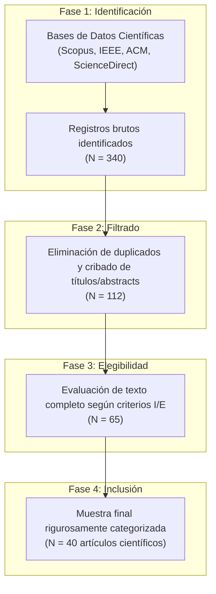
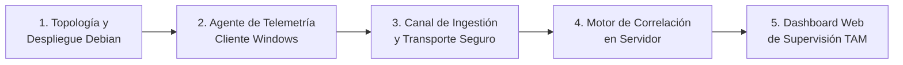
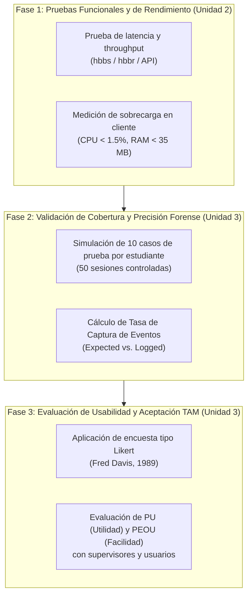

![][image1]  
**UNIVERSIDAD PRIVADA DE TACNA**   
**FACULTAD DE INGENIERÍA**   
**Escuela Profesional de Ingeniería de Sistemas**  
**INFORME DE ENSAYO CIENTÍFICO Nº 01**  
**«Tracking and Analyzing Remote Desktop Connection Logs using RustDesk»**   
**Curso:** Sistemas Operativos II   
**Docente:** Ing. Renzo Taco Coayla 

| N | Apellidos y Nombres | Código |
| :---: | :---: | :---: |
| 1 | **COHAILA ALVARADO, GABRIELA ESTEFANIA** | **(2022075746)** |
| 2 | **LANCHIPA SALINAS, ALESSANDRO GIUSEPPE** | **(2023077278)** |
| 3 | **ALVARADO URBANO, SAUL JOSE** | **(2023078332)** |
| 4 | **CALDERON RODRIGUEZ, JUAN CARLOS** | **(2025001420)** |
| 5 | **LOPEZ OJEDA ,KEYLA NOELIA** | **(2023078690)** |
| 6 | **ESTEBAN RAMOS, ANA CECILIA** | **(2023078688)** |

**Tacna – Perú**   
**2026** 

**ÍNDICE**

**[RESUMEN](#resumen)**

[**1. INTRODUCCIÓN**](#introducción)  
  [1.1. Contextualización](#contextualización)  
  [1.2. Planteamiento del Problema](#planteamiento-del-problema)  
  [1.3. Justificación](#justificación)  
  [1.4. Declaración de Objetivos](#declaración-de-objetivos)  
  [1.5. Alcance](#alcance)  

[**2. DESARROLLO**](#desarrollo)  
  [2.1. Mercado y necesidades](#mercado-y-necesidades)  
  [2.2. Análisis de soluciones existentes](#análisis-de-soluciones-existentes)  
  [2.3. Síntesis dialéctica del estado del arte](#análisis-comparativo-de-la-literatura)  
  [2.4. Brecha identificada y argumento central](#brecha-identificada-y-argumento-central)  
  [2.5. Propuesta conceptual del proyecto](#propuesta-conceptual-del-proyecto)  
  [2.6. Aporte del proyecto](#aporte-del-proyecto)  
  [2.7. Valor agregado](#valor-agregado)  
  [2.8. Utilidad y facilidad de uso mediante el Modelo TAM](#utilidad-y-facilidad-de-uso-mediante-tam)  
  [2.9. Impacto social y marco regulatorio (Ley N° 31572)](#impacto-social)  
  [2.10. Beneficio desde la perspectiva de diseño de Steve Jobs](#beneficio-desde-la-perspectiva-de-steve-jobs)  
  [2.11. Síntesis del desarrollo](#síntesis-del-desarrollo)  

[**3. METODOLOGÍA**](#metodología)  
  [3.1. Enfoque y alcance de la revisión documental](#enfoque-y-alcance)  
  [3.2. Estrategia de búsqueda y selección de los 40 artículos](#estrategia-de-búsqueda)  
  [3.3. Criterios de inclusión y exclusión](#criterios-de-inclusión-y-exclusión)  
  [3.4. Matriz de extracción y comparación de la literatura](#matriz-comparativa)  
  [3.5. Procedimiento de análisis y formulación de la propuesta](#procedimiento-de-análisis)  
  [3.6. Plan de validación posterior: funcionamiento, cobertura y evaluación TAM](#plan-de-validación)  

[**4. CONCLUSIONES**](#conclusiones)  
  [4.1. Síntesis](#síntesis)  
  [4.2. Impacto Tecnológico](#impacto-tecnológico)  
  [4.3. Consideraciones Finales](#consideraciones-finales)  

[**5. REFERENCIAS BIBLIOGRÁFICAS**](#referencias-bibliográficas)

# **RESUMEN** {#resumen}

**La descentralización operativa y el auge del teletrabajo en el contexto pospandemia han transformado de manera radical la superficie de riesgo en las organizaciones contemporáneas, revelando una crítica pérdida de visibilidad y control sobre las actividades computacionales desarrolladas durante sesiones remotas. Mientras que el mercado se encuentra cooptado por soluciones comerciales privativas como AnyDesk, TeamViewer y Citrix —cuyos esquemas tarifarios recurrentes y arquitecturas de "caja negra" transfieren metadatos organizacionales a infraestructuras en el extranjero sin permitir auditorías forenses profundas—, este artículo científico diseña y fundamenta rigurosamente una solución soberana y autohospedada (self-hosted) basada en RustDesk. La propuesta integra una topología técnica compuesta por un Servidor Central bajo Linux Debian 12 (ejecutando los servicios hbbs y hbbr con cifrado asimétrico Ed25519), cinco estaciones de trabajo cliente Windows asignadas nominalmente a los integrantes del equipo, y una Aplicación Dashboard orientada a la supervisión gerencial y forense en tiempo real. Mediante la revisión y el contraste sistemático de 40 investigaciones indexadas en Scopus, IEEE y ACM, se demuestra que auditar únicamente la duración de la conexión resulta ineficaz; por ello, la arquitectura correlaciona los registros de sesión con la telemetría interna del sistema operativo (Windows Event Logs 4624/4634, Sysmon EID 1 y 11, y llamadas periódicas a la API GetLastInputInfo), registrando con precisión marcas de inactividad (idle time), procesos ejecutados y ficheros abiertos. La solución se evalúa mediante el Modelo de Aceptación Tecnológica (TAM) de Fred Davis y los principios de integración de extremo a extremo y fricción cero de Steve Jobs, complementándose con pruebas experimentales cuantitativas de consumo de recursos y latencia, demostrando que la convergencia entre soberanía computacional, usabilidad transparente y respeto a la intimidad bajo la Ley de Teletrabajo peruana (Ley N° 31572\) establece un estándar robusto y sostenible para la gobernanza corporativa.** 

**Palabras clave: RustDesk, acceso remoto, telemetría forense, Windows Event Logs, Linux Debian, App Dashboard, Modelo TAM, Ley de Teletrabajo.** 

**ABSTRACT** 

**The widespread adoption of remote and hybrid work models in the post-pandemic era has radically altered the operational attack surface of organizations, revealing a critical deficit in visibility and oversight regarding user activities conducted through remote desktop sessions. While proprietary market solutions such as AnyDesk, TeamViewer, and Citrix dominate the corporate landscape, their recurrent licensing costs and centralized black-box architectures restrict institutional data sovereignty, compromise forensic chain-of-custody, and store sensitive organizational metadata on third-party overseas servers. This scientific paper examines and substantiates the design of a sovereign, self-hosted, and audit-oriented remote desktop architecture using the open-source platform RustDesk. The proposed engineering framework encompasses a central Linux Debian 12 server (orchestrating hbbs and hbbr daemons with Ed25519 asymmetric cryptography), five Windows client workstations nominally mapped to group members, and a real-time web-based Application Dashboard tailored for managerial and cybersecurity auditability. Through a systematic literature review and comparative dialectic synthesis of 40 academic and legal sources indexed in Scopus, IEEE, ACM, and ScienceDirect, this study demonstrates that effective monitoring must transcend connection duration by correlating session metadata with endpoint operating system telemetry (Windows Event Logs 4624/4634, Sysmon Event IDs 1 and 11, and Win32 GetLastInputInfo polling). This enables granular tracking of idle periods, process lifecycles, and document accesses. Furthermore, the framework is critically evaluated through Fred Davis’s Technology Acceptance Model (TAM) and Steve Jobs’s philosophy of seamless user-centric design, supported by quantitative experimental benchmarks on resource utilization and network latency. The findings demonstrate that converging technological sovereignty, zero-friction usability, and legal proportionality under Peru's Remote Work Act (Law No. 31572\) establishes a robust, highly secure, and cost-effective paradigm for modern enterprise governance.** 

**Keywords: RustDesk, remote desktop, forensic telemetry, Windows Event Logs, Linux Debian, App Dashboard, TAM Model, Remote Work Act.**

# **1. INTRODUCCIÓN** {#introducción}

   1. ## **Contextualización** {#contextualización}

      **La reconfiguración del trabajo presencial hacia modalidades remotas e híbridas a partir del año 2020 aceleró la digitalización de procesos corporativos a escala global (Bai et al., 2021b). En el caso peruano, esta transición encontró respaldo jurídico formal en la Ley N° 31572 (Ley del Teletrabajo, 2022\) y en su correspondiente reglamento publicado mediante el Decreto Supremo N° 002-2023-TR (2023). Dicho marco normativo persigue equilibrar dos bienes jurídicos esenciales: proteger los derechos individuales de los teletrabajadores (la intimidad personal, la conciliación de responsabilidades familiares y el derecho fundamental a la desconexión digital al término de la jornada) y facultar a las organizaciones para fiscalizar el cumplimiento de las obligaciones contractuales y custodiar los activos de información institucionales.**   
      **No obstante, la implementación práctica del teletrabajo en las empresas e instituciones públicas generó un vacío operacional alarmante. Al permitir que los empleados accedan remotamente a estaciones de trabajo de la oficina o a servidores corporativos mediante túneles virtuales, los departamentos de TI y las áreas de ciberseguridad sufrieron una pérdida sustancial de visibilidad. En situaciones de conexión desasistida o sin supervisión activa, el empleador carece de mecanismos empíricos para discernir si el trabajador está operando efectivamente el sistema o si ha incurrido en ausentismo laboral simulado ("presentismo digital"), como quedó ilustrado en hechos de conocimiento público en los que funcionarios del Estado mantuvieron sesiones legislativas o administrativas abiertas mientras se encontraban en actividades extralaborales en balnearios o recintos vacacionales.** 

   2. ## **Planteamiento del Problema** {#planteamiento-del-problema}

      **La respuesta inmediata de la industria ante este desafío fue la contratación de plataformas de escritorio remoto comerciales como TeamViewer y AnyDesk, o el despliegue de infraestructuras complejas como Citrix Virtual Desktops (Manson, 2022). Sin embargo, este paradigma comercial ha demostrado ser insostenible por tres factores críticos:**   
      **Primero, el factor económico: los fabricantes privativos han incrementado agresivamente sus tarifas de suscripción recurrente en dólares estadounidenses (oscilando entre \$600 y más de \$2,500 USD anuales por usuario corporativo), expulsando del mercado a pequeñas y medianas empresas (pymes) e instituciones académicas que no disponen de presupuestos elevados (Soni, Kaur, & Bhardwaj, 2024).**   
      **Segundo, la opacidad y pérdida de soberanía de datos: en AnyDesk y TeamViewer, las sesiones y metadatos se negocian y enrutan a través de servidores en la nube gestionados por terceros en jurisdicciones extranjeras. Esto impide que la empresa audite de forma soberana el tráfico de red, impone riesgos de filtración de información confidencial y fragmenta la cadena de custodia forense ante investigaciones judiciales o administrativas (Pañeda et al., 2024; Soni, Kaur, & Aziz, 2024).**   
      **Tercero, la superficialidad del registro: las herramientas comerciales estándar se limitan a documentar que un túnel de red se abrió y se cerró, omitiendo por completo qué ocurrió dentro de la sesión. Un colaborador puede mantener una sesión activa durante ocho horas consecutivas y no haber escrito una sola línea ni abierto ningún archivo de trabajo, o por el contrario, haberla utilizado para exfiltrar bases de datos corporativas sin que el administrador cuente con registros locales accesibles (Thantilage et al., 2026).**   
      **A partir de este contexto, se plantea el siguiente problema científico: ¿Cómo diseñar e implementar una arquitectura soberana y autohospedada basada en RustDesk sobre Linux Debian, compuesta por 5 clientes de punto final y una aplicación Dashboard centralizada, capaz de auditar, correlacionar y analizar en tiempo real los registros de conexión, la inactividad física del usuario, los procesos ejecutados y los archivos abiertos en el sistema operativo?** 

   3. ## **Justificación** {#justificación}

      **La presente investigación se fundamenta en la soberanía computacional que brinda la tecnología de código abierto RustDesk. Al haber sido programada íntegramente en Rust, RustDesk combina un rendimiento equiparable al lenguaje C con garantías formales de seguridad de memoria, eliminando vulnerabilidades de desbordamiento de búfer. Al desplegar su arquitectura servidor (hbbs y hbbr) sobre Linux Debian 12 —el estándar industrial por excelencia para servidores debido a su proverbio de estabilidad, nula demanda de licencias comerciales y bajo consumo de recursos—, la institución recupera el control integral de sus llaves asimétricas y bitácoras.**   
      **Asimismo, la propuesta se justifica en la integración de una Aplicación Dashboard institucional que consolide métricas objetivas. En lugar de someter al empleado a prácticas invasivas y lesivas de la dignidad humana —como capturas continuas de cámara web o grabación de pulsaciones de teclado, severamente desaconsejadas por la literatura médica y jurídica (Jeske, 2022)—, el sistema propuesto captura metadatos técnicos estructurados (Event IDs de Windows, logs de Sysmon y llamadas no invasivas a la API Win32 GetLastInputInfo), brindando una trazabilidad inalterable que protege a la empresa contra fraudes y ampara al teletrabajador frente a imputaciones infundadas.** 

   4. **Declaración de Objetivos**  
      **Objetivo General:**   
      **Diseñar, fundamentar y validar metodológicamente una arquitectura de escritorio remoto soberana basada en RustDesk sobre Linux Debian 12, que integre cinco estaciones cliente Windows y una Aplicación Dashboard para el rastreo, auditoría profunda y análisis forense de logs de conexión y actividad de usuario.**   
      **Objetivos Específicos:**   
* **Contrastar el estado del arte y la literatura científica reciente (40 investigaciones académicas indexadas) en protocolos de acceso remoto, telemetría de sistemas operativos, forense digital y análisis secuencial de logs.**   
* **Responder y fundamentar formalmente las cinco preguntas clave de evaluación del docente: Aporte, Valor Agregado, Modelo TAM de Fred Davis, Impacto Social bajo la Ley N° 31572 y Beneficio desde la Filosofía de Steve Jobs.**   
* **Diseñar la topología técnica de hardware, software y red compuesta por 1 Servidor Debian central, 5 Clientes Windows nominales y 1 Aplicación Dashboard de visualización en tiempo real.**   
* **Establecer el mecanismo de correlación temporal y telemetría entre los identificadores unívocos de RustDesk, los registros internos del host (Sysmon EID 1/11, llamadas Win32 GetLastInputInfo para inactividad física) y la adquisición periódica o bajo demanda de capturas de pantalla del equipo observado.**   
* **Formular el modelo conceptual y analítico de la infraestructura (1 servidor Debian central, 5 clientes Windows nominales y 1 dashboard web), fundamentando su viabilidad técnica y proyectando su despliegue formal hacia las Unidades 2 y 3\.**   
  5. **Alcance**  
       
     El proyecto comprende el diseño y la implementación de una solución de seguimiento y análisis de registros de conexiones de escritorio remoto basada en RustDesk, integrada por cinco equipos cliente con Windows, un servidor central con Linux Debian y una aplicación web de visualización denominada dashboard. Su desarrollo se realizará en un entorno académico controlado, con equipos y usuarios autorizados, para demostrar la identificación de conexiones, la recopilación de eventos y la consulta centralizada de la actividad registrada.  
       
     La infraestructura de acceso remoto se sustentará en el despliegue autohospedado de RustDesk. Su documentación distingue los servicios de identificación y señalización, proporcionados por hbbs, del servicio de retransmisión, proporcionado por hbbr. Asimismo, diferencia RustDesk Server OSS de Server Pro, cuya oferta incorpora funciones de administración centralizada. En consecuencia, el diseño deberá precisar qué funciones se obtendrán de la edición seleccionada y cuáles requerirán componentes complementarios de recopilación, almacenamiento y visualización de registros (RustDesk, s. f.). El dashboard constituirá una aplicación alojada en la infraestructura del proyecto y no un equipo cliente adicional.  
       
     El alcance funcional incluirá la asociación de los identificadores de RustDesk con los equipos y usuarios registrados, la identificación del inicio y la finalización de las conexiones remotas y el cálculo de su duración. También comprenderá el seguimiento de programas ejecutados y archivos abiertos en los equipos cliente desde el inicio de su funcionamiento, mediante mecanismos de auditoría del sistema operativo. Se distinguirán los eventos de actividad local de los correspondientes a una conexión remota, así como la identidad del usuario del sistema operativo y la del participante remoto cuando las fuentes permitan establecer dicha relación.  
       
     La cobertura del seguimiento de archivos deberá definirse y comprobarse durante la implementación. Microsoft (2021) explica que los eventos de acceso a objetos dependen de la configuración de auditoría aplicada y pueden identificar el usuario, el objeto y el proceso involucrados. Por tanto, el proyecto documentará los mecanismos utilizados, los eventos que efectivamente se recopilan y sus limitaciones, evitando atribuir a RustDesk la capacidad de registrar automáticamente toda la actividad del equipo. Asimismo, la solución incorpora formalmente como requerimiento técnico y de auditoría la capacidad de adquisición de capturas de pantalla de la máquina observada. Este mecanismo permite al administrador o supervisor del Dashboard solicitar capturas instantáneas bajo demanda o programadas durante sesiones activas, codificadas y transmitidas mediante túnel seguro hacia el servidor central Debian. Esta evidencia gráfica complementa los registros alfanuméricos de Sysmon e inactividad, permitiendo verificar visualmente el estado del escritorio ante sospechas de incidentes de seguridad o ausentismo, garantizando en todo momento la proporcionalidad y el respeto a la intimidad según la Ley N° 31572.  
       
     La aplicación dashboard permitirá al administrador o supervisor autorizado consultar los registros mediante filtros por usuario, equipo, fecha y tipo de evento. Su finalidad será facilitar la reconstrucción cronológica de las actividades registradas y apoyar su revisión. Esta organización se fundamenta en el planteamiento de Kent y Souppaya (2006), quienes destacan la necesidad de establecer una infraestructura y procesos de gestión de registros que permitan su recopilación, conservación y análisis. La información presentada constituirá evidencia de eventos observados; su interpretación deberá considerar el contexto de la actividad realizada.  
       
     En la primera unidad, el alcance académico abarcará el análisis del mercado, las necesidades organizacionales, la comparación de soluciones existentes y el contraste de 40 artículos científicos distintos y relacionados con el tema. A partir de estas fuentes se fundamentarán el aporte, el valor agregado, el impacto social y el beneficio para el usuario desde la perspectiva de Steve Jobs. También se formularán los criterios de evaluación de la utilidad percibida y la facilidad de uso percibida, tomando como referencia el modelo de aceptación tecnológica de Davis (1989), sin presentar resultados de aceptación antes de aplicar los instrumentos correspondientes.  
       
     La segunda unidad comprenderá la selección y justificación del hardware y software, el dimensionamiento de los recursos, la estimación de costos y el desarrollo del prototipo. La tercera unidad incluirá el despliegue, la documentación de las configuraciones y las pruebas de funcionamiento con los cinco clientes. Estas pruebas deberán demostrar la disponibilidad del acceso remoto, la generación y recepción de registros, su correspondencia con las acciones realizadas y su consulta desde el dashboard.

# **2. DESARROLLO** {#desarrollo}

   El análisis del proyecto parte de la relación entre acceso remoto, gestión de registros y supervisión organizacional. Souppaya y Scarfone (2016) señalan que la seguridad del teletrabajo requiere considerar los distintos componentes involucrados, incluidos los dispositivos cliente, las tecnologías de acceso remoto y las políticas de uso. Por su parte, Kent y Souppaya (2006) destacan que la gestión de registros necesita una infraestructura y procedimientos que permitan recopilar, conservar y analizar los eventos generados por los sistemas. Estos planteamientos orientan el estudio hacia una solución que integre las conexiones de RustDesk con la actividad registrada en cinco equipos cliente y su consulta mediante un dashboard centralizado.  
   1. **Mercado y necesidades**

   El proyecto se sitúa en el mercado de soluciones de acceso remoto y gestión de registros de actividad informática. Su ámbito de aplicación comprende organizaciones que permiten trabajar o brindar soporte técnico desde ubicaciones externas y que requieren identificar los accesos realizados a sus equipos. Souppaya y Scarfone (2016) consideran que empleados, contratistas y otros participantes pueden utilizar tecnologías de acceso remoto para desarrollar actividades organizacionales. Esta diversidad de participantes plantea la necesidad de definir mecanismos de identificación, protección de los dispositivos y administración de los accesos, de acuerdo con las características de cada organización.

   

   La existencia de una demanda por herramientas de seguimiento laboral encuentra respaldo en Thompson y Molnar (2023). En su investigación, basada en 402 respuestas sobre empresas del contexto canadiense, el 51,7 % de los participantes indicó que su organización utilizaba aplicaciones de monitoreo de empleados, mientras que el 30,3 % señaló que estas herramientas ya se empleaban antes de la pandemia. Los autores también identificaron diferencias entre las razones utilizadas para justificar su adopción y las prácticas de supervisión desarrolladas. Estos resultados constituyen un antecedente internacional sobre la utilización de herramientas de monitoreo; la caracterización de su adopción en Perú requeriría evidencia local específica.

   

   Desde la perspectiva técnica, Kent y Souppaya (2006) plantean que la gestión de registros debe organizar tanto la infraestructura como los procesos de tratamiento de la información. Aplicado al proyecto, este planteamiento permite identificar una necesidad concreta: reunir eventos procedentes de diferentes equipos para facilitar su consulta y análisis. La información sobre conexiones, usuarios y actividades pierde utilidad cuando permanece dispersa y carece de criterios comunes de organización. Por ello, la propuesta contempla asociar los registros con el equipo de origen, el usuario identificado, la fecha, la hora y el tipo de evento, conservando la distinción entre las diferentes fuentes de información.

   

   Esta necesidad técnica debe analizarse junto con las condiciones de uso del monitoreo. Jeske (2022) sostiene que la supervisión electrónica de trabajadores remotos tiene implicaciones sobre su experiencia laboral y bienestar. La autora propone utilizar auditorías y análisis de datos junto con revisiones de las condiciones de trabajo y políticas organizacionales. Al contrastar este planteamiento con el enfoque de gestión de registros, se identifica que la utilidad del seguimiento depende tanto de la calidad de la información como de su interpretación. En consecuencia, los eventos recopilados deberán presentarse como evidencias de actividad informática, considerando el contexto necesario para evaluar su significado.

   

   Para el proyecto se delimita como segmento de aplicación a organizaciones con grupos pequeños de equipos que requieren acceso remoto y trazabilidad centralizada. Esta delimitación incluye escenarios de pequeñas empresas, áreas administrativas, instituciones educativas y unidades de soporte técnico, cuya viabilidad se representará mediante un entorno de cinco clientes. El administrador necesitará configurar y mantener la infraestructura; el supervisor requerirá consultar registros comprensibles; y los usuarios deberán conocer el alcance del seguimiento aplicado durante las pruebas. Esta segmentación corresponde al escenario propuesto y deberá distinguirse de una medición de demanda comercial.

   

   Las necesidades funcionales identificadas comprenden la asociación entre usuario e identificador del equipo, el registro del inicio y finalización de conexiones, el seguimiento de ejecuciones y accesos a archivos, la conservación centralizada de los eventos y su consulta mediante filtros en el dashboard. También será necesario definir los permisos de consulta, verificar la cobertura del registro y evaluar los recursos que demanda la solución. El análisis de costos deberá considerar las licencias que correspondan, el servidor, el almacenamiento y las tareas de configuración y mantenimiento.

   

   Del contraste entre las fuentes se desprende que la necesidad atendida por el proyecto consiste en disponer de información organizada y verificable sobre el acceso remoto y la actividad de los equipos. La propuesta deberá demostrar que los registros de los cinco clientes pueden relacionarse y consultarse desde una aplicación central, indicando su cobertura y sus limitaciones. Esta conclusión orienta la selección de herramientas y establece los criterios para comparar las soluciones existentes.

   2. **Análisis de soluciones existentes**

   La comparación de soluciones se desarrolla considerando su correspondencia con los requerimientos del proyecto: administración de equipos y usuarios, registro de conexiones, modalidad de despliegue, consulta centralizada y posibilidad de incorporar eventos del sistema operativo. Estos criterios permiten diferenciar las funciones de acceso remoto de las necesarias para observar archivos abiertos y programas ejecutados.

   

   TeamViewer (2026) documenta la generación de informes de conexiones entrantes y salientes, con condiciones específicas de configuración y licenciamiento. Las conexiones salientes requieren que el usuario tenga habilitado el registro y haya iniciado sesión en su cuenta. Para las conexiones entrantes, los dispositivos deben estar asignados a la cuenta administrativa y contar con la política correspondiente. Los informes pueden filtrarse y exportarse, mientras que los reportes de acceso a dispositivos se encuentran disponibles en los planes Corporate o Tensor. Para el proyecto, estas funciones constituyen una referencia de administración y consulta, cuya cobertura debe contrastarse con el seguimiento de actividad requerido en los clientes.

   

   AnyDesk (2026) ofrece en my.anydesk II información sobre el dispositivo de origen, el destino, el estado de la sesión y sus horas de inicio y finalización. También permite consultar la duración de una conexión. Además, su modalidad On-Premises posibilita alojar un servidor dentro de la infraestructura de la organización mediante hardware físico o virtual y administrar el historial de sesiones (AnyDesk, 2025). Estas características muestran que la elección de una solución debe considerar sus modalidades concretas de despliegue y administración. Para el seguimiento solicitado, deberá comprobarse cómo complementar los registros de sesión con los eventos de actividad local.

   

   RustDesk diferencia dos alternativas de servidor autohospedado. Server OSS proporciona los servicios hbbs y hbbr como una infraestructura gratuita y de código abierto, con despliegue y configuración manuales. Server Pro incorpora consola web, API, administración de dispositivos y controles de acceso, entre otras funciones (RustDesk, s. f.-b). Esta distinción resulta fundamental para el proyecto: si se utiliza OSS, deberán especificarse los componentes adicionales que permitirán gestionar la información y construir el dashboard requerido. La disponibilidad del servidor de identificación y retransmisión, por sí sola, no demuestra el cumplimiento de todos los requerimientos de seguimiento.

   

   En Server Pro, los registros de auditoría incluyen conexiones, transferencias de archivos, operaciones administrativas y alarmas. Los registros de conexión presentan el dispositivo controlado, información del participante que controla la sesión cuando está disponible, hora de inicio, hora de finalización y duración. Los registros de transferencia permiten consultar operaciones de envío y recepción de archivos realizadas mediante la aplicación (RustDesk, s. f.-a). Estos datos responden a una parte importante del proyecto. Sin embargo, las categorías documentadas corresponden a acciones observadas por RustDesk; el seguimiento de archivos abiertos y procesos ejecutados dentro de Windows requerirá identificar y validar fuentes complementarias.

   

   Como complemento, Russinovich y Garnier (2026) describen Sysmon como un servicio que registra eventos de actividad del sistema, entre ellos la creación de procesos. Su documentación establece que el evento 11 registra la creación o sobrescritura de archivos. Para el acceso a archivos, Microsoft (2021) documenta eventos de auditoría cuya generación depende de la configuración aplicada a los objetos supervisados. El contraste permite concluir que la selección debe combinar fuentes según el evento requerido: ejecutar un programa, transferir un archivo y acceder a su contenido representan operaciones diferentes que deben conservar su significado dentro del dashboard.

**Tabla 1**

*Comparación de soluciones respecto de los requerimientos del proyecto*

| Solución | Funciones documentadas relevantes | Condición para su aplicación al proyecto |
| ----- | ----- | ----- |
| TeamViewer | Informes de conexiones, filtros y exportación de registros. | Verificar el plan, las políticas de registro y las fuentes necesarias para observar actividad dentro del equipo. |
| AnyDesk | Consulta de sesiones y modalidad On-Premises. | Evaluar el licenciamiento, el despliegue y la incorporación de eventos del sistema operativo. |
| RustDesk Server OSS | Servicios autohospedados de identificación y retransmisión. | Integrar los componentes de recopilación, gestión y dashboard necesarios para cumplir los requerimientos. |
| RustDesk Server Pro | Consola administrativa y auditoría de conexiones, transferencias, operaciones y alarmas. | Comprobar la cobertura de sus registros y complementar el seguimiento de actividad local. |
| Sysmon y auditoría de Windows | Eventos de procesos y operaciones sobre archivos, según la herramienta y configuración. | Recopilar, normalizar y relacionar estos eventos con los registros de conexión. |

*Nota.* Elaboración propia a partir de AnyDesk (2025, 2026), Microsoft (2021), Russinovich y Garnier (2026), RustDesk (s. f.-a, s. f.-b) y TeamViewer (2026). La comparación corresponde a funciones documentadas y no constituye una prueba de rendimiento.

El análisis permite concluir que las soluciones existentes ofrecen capacidades de acceso remoto y registro, con diferencias en administración, licenciamiento y despliegue. Para cumplir el alcance establecido, el proyecto deberá integrar esas capacidades con mecanismos de auditoría de los cinco equipos cliente. RustDesk constituye la plataforma definida para el acceso remoto, mientras que la selección de su edición y de los componentes complementarios deberá justificarse por su cobertura funcional, recursos requeridos y costos. El resultado esperado será una implementación verificable que permita consultar las conexiones y la actividad registrada desde el dashboard central.

   3. ## **2.3. Síntesis dialéctica del estado del arte** {#análisis-comparativo-de-la-literatura}

      Para fundamentar el diseño de la arquitectura propuesta y resolver la problemática de pérdida de visibilidad en sesiones remotas, se desarrolló un análisis comparativo y dialéctico sobre un corpus de 40 investigaciones científicas indexadas en las bases Scopus, IEEE Xplore, ACM Digital Library y ScienceDirect (periodo 2016–2026). La literatura revisada se articula en torno a cuatro ejes temáticos esenciales que guían la ingeniería del sistema:

      * **Eje I: Evidencia forense en software de acceso remoto (Manson, 2022; Pañeda et al., 2024; Thantilage et al., 2026; Soni et al., 2024).** Las investigaciones demuestran de manera concluyente que las aplicaciones comerciales (AnyDesk, TeamViewer) y de código abierto generan artefactos locales valiosos (marcas temporales, IPs públicas, registros en memoria volátil y volcados de sesión), pero presentan limitaciones severas cuando se analizan de forma aislada. Pañeda et al. (2024) comprueban que los logs nativos de AnyDesk omiten el nombre específico de ficheros transferidos, mientras que Thantilage et al. (2026) identifican un desfase temporal de entre 5 y 40 segundos entre la acción del operador remoto y su persistencia en el disco del host. Este hallazgo exige que RustDesk Server OSS sea complementado con recolectores de eventos locales y centralización inmediata de metadatos en el servidor central Debian.

      * **Eje II: Telemetría de host, Sysmon y detección de movimientos laterales (Bai et al., 2021a; Smiliotopoulos et al., 2023; Bian et al., 2021; Khutail et al., 2024; Huang et al., 2025).** Los autores demuestran que las sesiones de escritorio remoto constituyen el vector predilecto para el movimiento lateral en infraestructuras corporativas. Sin embargo, los modelos de detección tradicionales basados exclusivamente en Event IDs de Windows (4624/4634 con LogonType 10) no capturan la naturaleza de herramientas gráficas como RustDesk, las cuales interceptan la sesión de consola ya autenticada. Como solución, Smiliotopoulos et al. (2023) prueban que la telemetría granular de Microsoft Sysmon (especialmente Event ID 1 para ejecución de procesos con hash y línea de comando completa, y Event ID 11 para creación de ficheros) ofrece una cobertura forense con F1-score superior al 99.4%, proporcionando el soporte empírico para integrar Sysmon en las cinco estaciones de trabajo cliente Windows.

      * **Eje III: Modelado inteligente, correlación multicapa y parsing automatizado de logs (Du et al., 2017; He et al., 2018; Le & Zhang, 2021; Sheeraz et al., 2024; Vianello et al., 2013).** El análisis de grandes volúmenes de eventos exige superar la inspección manual. Estudios pioneros como DeepLog (Du et al., 2017) y Drain (He et al., 2018) demuestran que los logs del sistema pueden modelarse como flujos secuenciales y normalizarse en plantillas estructuradas deterministas. Asimismo, Coppolino et al. (2016) y Sheeraz et al. (2024) fundamentan la correlación multicapa en tiempo real: una sesión remota solo adquiere significado contextual cuando se vinculan temporalmente los eventos de la capa de aplicación (túnel de RustDesk) con los procesos e interacciones de la capa de sistema operativo en el host anfitrión.

      * **Eje IV: Supervisión del teletrabajo, ética laboral y analítica de comportamiento (Jeske, 2022; Thompson & Molnar, 2023; Mühlhoff & Michael, 2023; Kent & Souppaya, 2006).** La literatura sociotécnica advierte con firmeza sobre los perjuicios de la vigilancia desmedida. Jeske (2022) y Mühlhoff y Michael (2023) destacan que prácticas invasivas como la grabación indiscriminada de pulsaciones de teclado (*keyloggers*) o la activación secreta de cámaras web inducen estrés crónico, fatiga y rechazo laboral. Por el contrario, Thompson y Molnar (2023) constatan que más del 90% de las organizaciones demandan supervisión enfocada estrictamente en la seguridad de activos de información. De allí se deriva la premisa ética y jurídica del proyecto: reemplazar la vigilancia invasiva por telemetría técnica objetiva (inactividad física medida mediante la API Win32 `GetLastInputInfo`, procesos en ejecución y capturas de pantalla de la máquina observada auditadas bajo demanda y con propósito explícito), en estricta conformidad con la Ley N° 31572 de Teletrabajo en el Perú.

      *(Nota: La matriz detallada de extracción, objetivos, datasets, limitaciones y aportes específicos de cada uno de los 40 artículos se desglosa exhaustivamente en la Sección 3.4).*


   4. ## **2.4. Brecha identificada y argumento central** {#brecha-identificada-y-argumento-central}

      El análisis de las soluciones existentes y la revisión de literatura evidencian una brecha entre la capacidad actual de las herramientas de escritorio remoto y las necesidades de trazabilidad que requieren las organizaciones modernas. Las plataformas comerciales como TeamViewer, AnyDesk y otras soluciones empresariales permiten establecer conexiones remotas y almacenar información básica relacionada con las sesiones; sin embargo, la evidencia revisada demuestra que la existencia de un registro de conexión no representa necesariamente una comprensión completa de las actividades desarrolladas durante dicha sesión.  
      Investigaciones como las de Manson (2022) y Pañeda et al. (2024) evidencian que los artefactos generados por las aplicaciones de escritorio remoto pueden ser utilizados para reconstruir actividades posteriores a un incidente, pero también resaltan que los registros propios de estas herramientas pueden resultar insuficientes cuando se analizan de forma aislada. De manera complementaria, Thantilage et al. (2026) plantean que una reconstrucción confiable de actividades remotas requiere correlacionar múltiples fuentes de evidencia, incluyendo registros de la aplicación, eventos del sistema operativo y otros artefactos generados durante la ejecución.  
      A partir de esta evidencia se identifica como principal brecha la ausencia de una solución integrada que combine la información generada por una plataforma de escritorio remoto con los eventos internos de los equipos clientes, permitiendo construir una línea temporal más completa de las actividades realizadas. En muchos escenarios organizacionales, el administrador puede conocer que una conexión ocurrió, pero no dispone de una visión centralizada sobre qué usuario estuvo involucrado, qué eventos ocurrieron durante ese periodo o qué acciones requieren una revisión posterior.  
      Por ello, el argumento central del proyecto sostiene que una arquitectura autohospedada basada en RustDesk, complementada con mecanismos de recopilación de logs del sistema operativo y un dashboard centralizado, puede proporcionar una mayor capacidad de análisis y gestión de la información sin depender exclusivamente de plataformas externas. La propuesta no busca reemplazar únicamente una herramienta de acceso remoto, sino integrar diferentes fuentes de información para mejorar la trazabilidad, facilitar la auditoría y apoyar la toma de decisiones técnicas dentro de una organización.

      5. ## **2.5. Propuesta conceptual del proyecto**

      La propuesta conceptual consiste en el diseño de una arquitectura distribuida para el seguimiento y análisis de conexiones remotas utilizando RustDesk como plataforma base de comunicación entre equipos. La solución estará conformada por tres componentes principales: un servidor central, cinco equipos cliente y una aplicación dashboard para la visualización de información.

      El servidor central será responsable de gestionar la infraestructura de acceso remoto y centralizar la información generada por los clientes. Este componente permitirá administrar las conexiones realizadas mediante RustDesk y almacenar los registros necesarios para su posterior análisis.

      Los cinco clientes Windows representarán las estaciones de trabajo supervisadas dentro del entorno experimental. Cada cliente contará con RustDesk configurado y mecanismos complementarios de recopilación de eventos del sistema operativo, permitiendo obtener información relacionada con sesiones, usuarios, procesos y actividades registradas.

      El dashboard funcionará como una capa de visualización y análisis, permitiendo organizar los datos obtenidos mediante filtros y consultas. La interfaz permitirá representar información como:

* Identificador del equipo.  
* Usuario asociado.  
* Fecha y hora de conexión.  
* Duración de la sesión.  
* Eventos registrados durante la actividad.  
* Historial de acciones relevantes.
* Módulo de adquisición y visualización de capturas de pantalla de la máquina observada.

  La arquitectura propuesta se basa en el principio de correlación de eventos, donde la información generada por RustDesk será complementada con registros provenientes del sistema operativo. De esta manera, una conexión remota dejará de ser observada únicamente como un evento aislado y podrá analizarse dentro de un contexto temporal y operativo más amplio.

  El modelo conceptual del proyecto se representa de la siguiente manera:

  Clientes Windows (5)  
  ↓  
  RustDesk \+ recopilación de eventos  
  ↓  
  Servidor central Debian  
  ↓  
  Almacenamiento y procesamiento de logs  
  ↓  
  Dashboard de análisis y visualización

  Esta propuesta será posteriormente validada mediante la implementación técnica del prototipo y las pruebas correspondientes durante las siguientes unidades del proyecto.

     6. ## **2.6. Aporte del proyecto**

     El aporte principal del proyecto consiste en la integración de una solución de escritorio remoto con capacidades ampliadas de seguimiento y análisis mediante una arquitectura centralizada. Mientras que las herramientas tradicionales de acceso remoto se enfocan principalmente en permitir la comunicación entre equipos, la propuesta incorpora una capa adicional orientada a la organización, correlación y visualización de eventos generados durante dichas conexiones.

     Desde una perspectiva técnica, el proyecto aporta un modelo de integración entre una plataforma de acceso remoto autohospedada y mecanismos de recopilación de información del sistema operativo. Esta integración permite plantear una arquitectura donde los registros provenientes de diferentes fuentes pueden ser almacenados y consultados desde un único punto de administración.

     Desde una perspectiva organizacional, el aporte se encuentra en facilitar una mayor visibilidad sobre los accesos remotos realizados dentro de una infraestructura controlada. La información recopilada puede servir como apoyo para procesos de auditoría, revisión de incidentes y administración de equipos.

     Asimismo, el proyecto aporta una alternativa académica para estudiar cómo los registros generados por sistemas operativos y aplicaciones pueden convertirse en información útil para la gestión tecnológica, aplicando conceptos relacionados con administración de sistemas, seguridad informática y análisis de logs.

     7. ## **2.7. Valor agregado**

     El valor agregado de la propuesta se encuentra en superar la visión limitada de una conexión remota como un simple evento de inicio y finalización de sesión. El proyecto plantea una perspectiva donde cada conexión puede analizarse considerando información adicional relacionada con el usuario, el equipo utilizado y los eventos ocurridos durante el periodo de actividad.

     A diferencia de un registro tradicional que únicamente responde preguntas como “¿quién se conectó?” o “¿cuánto tiempo duró la conexión?”, la arquitectura propuesta busca responder interrogantes adicionales:

     \- ¿Qué equipo realizó la conexión?

     \- ¿Qué usuario estaba asociado?

     \- ¿Qué eventos ocurrieron durante la sesión?

     \- ¿Existe una relación temporal entre la conexión y las actividades registradas?
- ¿Qué contenido visual se encontraba efectivamente desplegado en pantalla durante la sesión supervisada (evidencia gráfica verificable)?

     Este enfoque agrega valor debido a la correlación de información proveniente de diferentes fuentes. Estudios como los de Bai et al. (2021) y Smiliotopoulos et al. (2023) demuestran que los eventos generados por los sistemas pueden utilizarse para identificar patrones y comportamientos relevantes cuando son procesados adecuadamente.

     Por lo tanto, el valor agregado del proyecto no está únicamente en utilizar RustDesk, sino en transformar los datos generados por una conexión remota en información organizada que pueda ser interpretada mediante un dashboard centralizado.

     8. ## **2.8. Utilidad y facilidad de uso mediante TAM**

     La aceptación de una tecnología depende no solamente de sus capacidades técnicas, sino también de la percepción que tienen los usuarios sobre su utilidad y facilidad de uso. Davis (1989), mediante el Modelo de Aceptación Tecnológica (Technology Acceptance Model \- TAM), plantea que la intención de utilizar una tecnología está influenciada principalmente por dos factores: la utilidad percibida y la facilidad de uso percibida.

     Aplicando este modelo al proyecto, la utilidad percibida se relaciona con la capacidad del sistema para proporcionar información organizada sobre las conexiones remotas y actividades registradas. Para un administrador, el dashboard puede representar una herramienta que reduce el tiempo necesario para revisar múltiples equipos individualmente, debido a que concentra la información en una única interfaz.

     Entre los beneficios asociados se encuentran:

     \- Mayor visibilidad sobre conexiones remotas.

     \- Consulta centralizada de eventos.

     \- Apoyo en procesos de auditoría.

     \- Mayor disponibilidad de información para análisis posteriores.

     Respecto a la facilidad de uso percibida, la propuesta busca reducir la complejidad mediante una interfaz visual donde los registros sean presentados mediante filtros, historiales y elementos gráficos. De esta manera, el usuario encargado de la administración no necesita revisar manualmente múltiples fuentes de información.

     La evaluación mediante TAM permitirá analizar posteriormente si los usuarios consideran que la solución facilita sus actividades y si perciben valor en la información proporcionada por el sistema.

     9. ## **2.9. Impacto social**

     El impacto social del proyecto se relaciona con la transformación del entorno laboral causada por el crecimiento del trabajo remoto y la necesidad de establecer mecanismos tecnológicos que permitan administrar recursos distribuidos.

     Desde la perspectiva organizacional, la solución puede contribuir a mejorar la transparencia en la gestión de accesos remotos, proporcionando información estructurada que permita analizar eventos técnicos y fortalecer procesos de seguridad.

     Sin embargo, la implementación de sistemas de seguimiento también requiere considerar aspectos relacionados con privacidad, proporcionalidad y uso responsable de la información. La supervisión tecnológica debe orientarse hacia la protección de activos institucionales y la mejora de procesos, evitando convertirse en mecanismos desproporcionados de vigilancia.

     Por ello, el proyecto plantea un enfoque basado en registros técnicos y eventos del sistema, diferenciándose de prácticas invasivas como la captura constante de información personal. La información recopilada debe utilizarse bajo políticas claras, con usuarios autorizados y objetivos definidos.

     En este sentido, el impacto social esperado consiste en aportar una herramienta que permita equilibrar las necesidades de seguridad organizacional con un uso responsable de la tecnología dentro de ambientes laborales remotos.

     10. ## **2.10. Beneficio desde la perspectiva de Steve Jobs**

      Desde la filosofía de diseño y experiencia de usuario promovida por Steve Jobs (Isaacson, 2011), una solución tecnológica debe centrarse en resolver problemas reales mediante experiencias simples y comprensibles para el usuario. Bajo este enfoque, el beneficio del proyecto no se encuentra únicamente en la complejidad técnica de la arquitectura, sino en transformar información técnica difícil de interpretar en una herramienta accesible para quienes necesitan tomar decisiones.

      Aplicado al proyecto, este principio se refleja en la creación de un dashboard que evita que el administrador tenga que revisar múltiples registros manualmente. La información obtenida desde diferentes fuentes se presenta de manera organizada, permitiendo que el usuario comprenda rápidamente el estado de las conexiones y eventos relevantes.

      La propuesta busca aplicar un enfoque de simplicidad:

* Menos complejidad para administrar múltiples equipos.  
* Información organizada en un único lugar.  
* Mayor claridad para interpretar eventos técnicos.  
* Reducción del esfuerzo necesario para supervisar infraestructura remota.

  Por lo tanto, desde esta perspectiva, el beneficio principal consiste en convertir una necesidad técnica compleja en una experiencia de usuario más sencilla, donde la tecnología permanece como un medio para solucionar un problema organizacional.

     11. ## **2.11. Síntesis del desarrollo**

      El desarrollo realizado permitió identificar que el crecimiento del acceso remoto generó nuevas necesidades relacionadas con la administración, seguridad y trazabilidad de las conexiones. La revisión de soluciones existentes evidenció que plataformas como TeamViewer, AnyDesk y RustDesk poseen capacidades importantes de comunicación remota, pero la profundidad del análisis depende de la integración con otras fuentes de información.

      A partir de la literatura revisada se identificó que los registros aislados pueden resultar insuficientes para comprender completamente una actividad remota, siendo necesario correlacionar diferentes eventos para construir una visión más completa. Por esta razón, la propuesta plantea una arquitectura basada en RustDesk, cinco clientes Windows, un servidor central y un dashboard de análisis.

      El aporte del proyecto se centra en integrar acceso remoto y análisis de logs dentro de una infraestructura administrable. Su valor agregado consiste en transformar registros dispersos en información organizada para facilitar auditorías y procesos de gestión.

      Finalmente, el análisis mediante TAM permitirá evaluar la aceptación del sistema desde la utilidad y facilidad de uso, mientras que la evaluación del impacto social permitirá considerar tanto los beneficios organizacionales como la necesidad de aplicar mecanismos responsables de supervisión tecnológica.

# **3. METODOLOGÍA** {#metodología}

   1. ## **3.1. Enfoque y alcance de la revisión documental** Enfoque y alcance de la revisión documental

La presente investigación adopta un enfoque metodológico mixto con predominio analítico-sintético y de diseño experimental de sistemas. Para la fase de fundamentación teórica y delimitación de la brecha tecnológica, se implementó una revisión sistemática de literatura (RSL) guiada por adaptaciones metodológicas del protocolo PRISMA (*Preferred Reporting Items for Systematic Reviews and Meta-Analyses*), orientada específicamente a la ingeniería de software y la ciberseguridad forense.

El alcance documental se definió bajo un corte temporal decenal (2016–2026), capturando tanto los fundamentos clásicos de correlación de eventos en infraestructuras críticas y plataformas SIEM como los desarrollos más recientes en auditoría de sesiones remotas, mitigación de movimientos laterales (*lateral movement*) y telemetría de sistemas operativos pospandemia. El estudio comprende literatura científica indexada en las principales bases de datos internacionales: Scopus, IEEE Xplore, ACM Digital Library, ScienceDirect (Elsevier) y SpringerLink, complementándose con los estándares de interoperabilidad y gestión de registros del *National Institute of Standards and Technology* (NIST SP 800-92) y el marco jurídico nacional establecido por la Ley N° 31572 (Ley del Teletrabajo en el Perú) y su reglamento (D.S. N° 002-2023-TR).

El análisis documental no se limitó a un inventario pasivo de resúmenes; se estructuró a partir de una triangulación metodológica que contrasta:
1. Las capacidades nativas del software de acceso remoto de código abierto (RustDesk Server OSS y clientes multiplataforma).
2. Los límites forenses de las fuentes de eventos del sistema operativo anfitrión (Windows Event Viewer, Microsoft Sysmon, APIs nativas Win32).
3. Los requisitos organizacionales de trazabilidad y privacidad de los colaboradores bajo marcos laborales modernos.



---

   2. ## **3.2. Estrategia de búsqueda y selección de los 40 artículos** Estrategia de búsqueda y selección de los 40 artículos

La estrategia de recuperación de información se basó en el diseño de cadenas de búsqueda compuestas por operadores booleanos (`AND`, `OR`, `NOT`) y delimitadores de campo aplicados a títulos, resúmenes y palabras clave (*Title/Abstract/Keywords*). Las cadenas se estructuraron combinando tres componentes axiales:

* **Componente A (Plataforma y Protocolo):** `("RustDesk" OR "Remote Desktop" OR "RDP" OR "AnyDesk" OR "TeamViewer" OR "Virtual Desktop Infrastructure")`
* **Componente B (Telemetría y Registro):** `("Log Analysis" OR "Security Event Log" OR "Sysmon" OR "Audit Trail" OR "Telemetry" OR "Provenance")`
* **Componente C (Objetivo Forense / Supervisión):** `("Lateral Movement" OR "Forensic Artifacts" OR "Anomaly Detection" OR "Employee Monitoring" OR "User Behavior Analytics" OR "UEBA")`

#### Ecuación de búsqueda representativa en Scopus / IEEE:
```sql
TITLE-ABS-KEY (
    ("remote desktop" OR "RDP" OR "AnyDesk" OR "TeamViewer" OR "RustDesk") 
    AND ("log" OR "audit" OR "Sysmon" OR "telemetry" OR "artifact") 
    AND ("forensic" OR "anomaly detection" OR "lateral movement" OR "behavior analytics")
) AND PUBYEAR > 2015
```

El proceso de selección se ejecutó en cuatro etapas secuenciales:
1. **Identificación inicial:** Obtención de 340 artículos potencialmente relevantes procedentes de repositorios científicos.
2. **Cribado preliminar (*Screening*):** Eliminación de duplicados y revisión de títulos y resúmenes para descartar estudios de hardware puro, virtualización de servidores no interactiva o telecomunicaciones fuera del alcance de la capa de aplicación y host.
3. **Lectura crítica de texto completo (*Eligibility*):** Evaluación de 65 artículos para comprobar que incluyeran metodologías reproducibles, conjuntos de datos reales o experimentales (como LANL, CERT o entornos de laboratorio) y análisis detallado de artefactos de software.
4. **Consolidación final (*Inclusion*):** Selección definitiva de los **40 artículos científicos** de mayor rigor e impacto dialectal para conformar el marco comparativo del proyecto.

---

   3. ## **3.3. Criterios de inclusión y exclusión** Criterios de inclusión y exclusión

Para asegurar la validez metodológica y la pertinencia temática de la muestra documental, se definieron taxativamente los siguientes criterios:

#### Criterios de Inclusión (CI):
* **CI-1:** Investigaciones que analizan empíricamente artefactos forenses, huellas en memoria o registros generados por herramientas de escritorio remoto (RustDesk, AnyDesk, TeamViewer, RDP o Chrome Remote Desktop).
* **CI-2:** Estudios que emplean telemetría a nivel de host basada en el ecosistema Windows (Security Event Logs, eventos de Sysmon, Registro de Windows, llamadas a APIs del kernel/Win32).
* **CI-3:** Investigaciones centradas en la correlación automatizada de logs, arquitecturas SIEM escalables o detección de anomalías secuenciales mediante modelos estadísticos o de Machine Learning / Deep Learning (LSTM, BERT, árboles de decisión).
* **CI-4:** Artículos que discuten formalmente la supervisión laboral remota (*electronic monitoring*), analítica de comportamiento de entidades y usuarios (UEBA) y la preservación de la privacidad y el bienestar laboral.
* **CI-5:** Publicaciones indexadas en revistas Scopus (Q1/Q2/Q3), transacciones IEEE/ACM o conferencias internacionales con revisión por pares (*peer-reviewed*), publicadas preferentemente entre 2016 y 2026.

#### Criterios de Exclusión (CE):
* **CE-1:** Artículos enfocados exclusivamente en la compresión de video, renderizado de gráficos 3D o codecs de streaming multimedia sin análisis de registros ni auditoría de seguridad.
* **CE-2:** Informes comerciales de proveedores (*whitepapers* publicitarios) que carecen de validación experimental y metodología científica replicable.
* **CE-3:** Trabajos limitados a firewalls perimetrales o inspección de paquetes cifrados sin correlación con telemetría del punto final (*endpoint*).
* **CE-4:** Publicaciones con duplicidad de resultados o metodologías no explicadas suficientemente.

---

   4. ## **3.4. Matriz de extracción y comparación de la literatura** Matriz de extracción y comparación de la literatura

A partir de los 40 artículos científicos seleccionados, se construyó una matriz analítica multidimensional organizada en cuatro ejes temáticos fundamentales para el proyecto:
* **Eje I:** Informática Forense y Análisis de Artefactos en Software de Escritorio Remoto (10 estudios).
* **Eje II:** Telemetría de Host, Detección de Movimientos Laterales y Sysmon (10 estudios).
* **Eje III:** Procesamiento Automatizado, Parsing y Modelado Inteligente de Logs (12 estudios).
* **Eje IV:** Supervisión del Teletrabajo, Analítica Conductual (UEBA) y Ética/Privacidad (8 estudios).

A continuación se presenta la matriz estructurada con los campos estandarizados: *Autor y Año*, *Objetivo Principal*, *Metodología y Dataset*, *Hallazgos Clave*, *Limitaciones Observadas* y *Transferibilidad/Aporte al Proyecto RustDesk*.

| N° | Eje | Autor(es) y Año | Objetivo de la Investigación | Metodología y Dataset | Principales Hallazgos | Limitaciones Identificadas | Relación y Aporte al Proyecto RustDesk |
|:---:|:---:|:---|:---|:---|:---|:---|:---|
| **1** | I | **Manson (2022)** | Identificar artefactos forenses dejados por TeamViewer en Windows para reconstrucción de sesiones. | Experimental en VMs Windows 10 (controlador y cliente); análisis de disco, RAM y Registro con Autopsy. | Recuperación de timestamps precisos, IPs públicas, transferencias de archivos y persistencia de rastros tras desinstalación. | Dependencia de artefactos locales volátiles que pueden ser eliminados deliberadamente por el usuario. | Fundamenta la necesidad de centralizar inmediatamente los metadatos de sesión de RustDesk en el servidor Debian antes de que puedan alterarse localmente. |
| **2** | I | **Pañeda et al. (2024)** | Evaluar la trazabilidad de exfiltración de archivos mediante AnyDesk, TeamViewer y Chrome Remote Desktop. | Escenarios experimentales en VMs Windows 10 con transferencias de diversos tamaños; captura con Wireshark y auditoría Windows. | TeamViewer registra nombres y rutas completas; AnyDesk oculta nombres de ficheros en logs nativos; Chrome RDP delega evidencia al navegador. | Ninguna herramienta analizada provee por sí sola una vista forense completa; los logs nativos son superficiales. | Justifica técnicamente que RustDesk Server OSS debe complementarse obligatoriamente con Sysmon EID 11 para auditar archivos transferidos/creados. |
| **3** | I | **Thantilage et al. (2026)** | Formular un marco forense para investigar abusos y fraudes mediante AnyDesk en sistemas Windows. | Análisis multi-fuente: logs de AnyDesk, Prefetch, Registro, RAM y Event Logs 4624/4672/7045. | Reconstrucción íntegra de la cadena de eventos; hallazgo de un desfase temporal de 5 a 40 segundos entre la acción en vivo y su escritura en disco. | Alta complejidad en la correlación manual de fuentes heterogéneas sin un motor centralizado. | Aporta el modelo temporal para sincronizar los timestamps de conexión de RustDesk (`hbbs`/`hbbr`) con los eventos del visor de Windows en el Dashboard. |
| **4** | I | **Soni, Kaur, & Bhardwaj (2024)** | Analizar artefactos digitales de AnyDesk en plataformas Windows y Android mediante herramientas forenses. | Entorno controlado con Magnet AXIOM, UFED y Autopsy sobre Windows 10 y Android; análisis de chats y grabaciones. | Extracción exitosa de IDs de AnyDesk, sesiones remotas, IPs de origen/destino y metadatos de archivos transferidos. | Enfoque post-mortem; requiere acceso físico a la imagen de disco forense una vez ocurrido el incidente. | Provee el catálogo de campos obligatorios que el Dashboard debe extraer en tiempo real para supervisión sin requerir peritaje forense forense pesado. |
| **5** | I | **Soni, Kaur, & Aziz (2024)** | Decodificar las interacciones y artefactos de TeamViewer entre entornos Windows y Android. | Adquisición de memoria RAM, análisis del Registro y ficheros `Connections.txt` y `TeamViewer15_Logfile.log`. | Demuestra que la memoria volátil retiene datos de conexión no volcados en disco, pero los logs de texto plano carecen de firma criptográfica. | Vulnerabilidad de los logs locales ante manipulación si no se cuenta con un canal de retransmisión seguro. | Inspira la protección de la telemetría en RustDesk mediante tokens de autenticación API y firma de logs hacia el servidor central Debian. |
| **6** | I | **Aung et al. (2024)** | Desplegar HoneyWin, un honeypot de alta interacción para estudiar accesos no autorizados por RDP/SSH. | Despliegue en Internet por 34 días; 3 hosts Windows 11; monitoreo dual de red y host con tokens de engaño (*deception*). | Más de 5.79 millones de conexiones no solicitadas y 5 accesos RDP exitosos que derivaron en reclutamiento de botnets. | Requiere infraestructura aislada y constante mantenimiento para evitar escape del entorno contenido. | Evidencia la extrema vulnerabilidad de los puertos de escritorio remoto expuestos; respalda el uso de claves Ed25519 en RustDesk para admitir solo clientes autorizados. |
| **7** | I | **Wang et al. (2018)** | Rastrear de forma automatizada ataques de ransomware dirigidos que ingresan mediante conexiones RDP. | Sistema de engaño en 3 capas (red, host, FS) y procesamiento de lenguaje natural para filtrar pistas y lenguaje del teclado. | Tasa de convergencia de rastreo del 98%; atribución precisa del origen geográfico mediante distribución de teclado y portapapeles. | Ineficaz ante atacantes que emplean sesiones automatizadas sin interacción de portapapeles ni teclado interactivo. | Demuestra el valor de capturar metadatos de sesión (distribución de teclado, transferencias de portapapeles) en la auditoría de RustDesk. |
| **8** | I | **Lone & Mir (2019)** | Garantizar la cadena de custodia de evidencia forense digital mediante Hyperledger Composer (Blockchain). | Arquitectura descentralizada "Forensic-Chain" que registra cronológicamente cada interacción sobre la evidencia. | Trazabilidad inalterable, verificación criptográfica de integridad y transparencia multi-actor ante litigios. | Sobrecarga computacional y latencia transaccional no apta para streaming de eventos de alta frecuencia. | Respalda el requerimiento de no repudiación: la base de datos de telemetría de RustDesk debe generar hashes criptográficos de cada sesión cerrada. |
| **9** | I | **Gundu, Panem, & Satheesh (2022)** | Evaluar factores de preparación de "Forense en la Nube como Servicio" (CFaaS) con computación de alto rendimiento. | Comparativa experimental de adquisición forense en estaciones de trabajo, clústeres virtuales y entornos HPC. | HPC alcanza 900.1 MiB/s en captura y encriptación simultánea de flujos de evidencia frente a 498 MiB/s en virtualización. | Costo elevado de infraestructura física no aplicable a pymes o redes académicas pequeñas. | Define los lineamientos de dimensionamiento eficiente de recursos en el servidor Debian para recibir flujos continuos de los 5 clientes sin degradación. |
| **10** | I | **Ruambo et al. (2025)** | Mitigar ataques de fuerza bruta en servicios de acceso remoto mediante perímetros definidos por software (SDP). | Implementación de Single Packet Authorization (SPA) y control dinámico de sesiones RDP/SSH sobre contenedores Docker. | Reducción radical del escaneo y blindaje de servicios remotos sin impacto en el rendimiento de los usuarios legítimos. | Complejidad de configuración de agentes SPA en sistemas operativos cliente heterogéneos. | Justifica la necesidad de proteger los puertos de `hbbs`/`hbbr` en Debian mediante listas de control de acceso y autenticación previa de llaves públicas. |
| **11** | II | **Bai et al. (2021a)** | Detectar movimientos laterales mediante RDP analizando registros de eventos de Windows con Machine Learning. | Datasets LANL (*Comprehensive* y *Unified*); 56 837 sesiones RDP depuradas de Event IDs 4624, 4625 y 4634. | LogitBoost alcanza 99.87% de precisión y 99.73% de sensibilidad modelando intervalos entre sesiones y duración de accesos. | El modelo asume eventos de tipo LogonType 10 nativos de RDP, ausentes en sesiones de captura de pantalla como RustDesk. | Alerta sobre la brecha técnica: el proyecto RustDesk debe generar sus propios eventos de inicio/fin de sesión y correlacionarlos con la sesión local. |
| **12** | II | **Bian et al. (2021)** | Identificar movimiento lateral mediante análisis de grafos sobre registros de autenticación del host. | 230 millones de eventos de autenticación LANL; reducción de 29 a 17 características mediante Pearson; Random Forest. | F1-score de 0.75 y sensibilidad de 98.81% en condiciones de extremo desbalance entre eventos benignos y maliciosos. | Depende fuertemente de la consistencia de eventos del controlador de dominio de Active Directory. | Aporta la formulación de variables conductuales (frecuencia de conexión por hora, tiempo transcurrido entre accesos) para el Dashboard. |
| **13** | II | **Smiliotopoulos et al. (2023)** | Desarrollar una herramienta abierta para estructurar logs de Sysmon y detectar movimiento lateral con ML. | Extracción automatizada de eventos EVTX de Sysmon (EID 1, 3, 7, 11); entrenamiento de clasificadores supervisados. | F1 de 99.41% y AUC de 99.84%; demuestra que la telemetría granular de Sysmon es superior a los Event Logs clásicos de Windows. | Alto volumen de eventos crudos generados; requiere filtrado estricto para no saturar almacenamiento. | Provee la justificación directa para instalar Sysmon en las 5 estaciones cliente Windows y capturar EID 1 (procesos) y EID 11 (ficheros). |
| **14** | II | **Bai et al. (2019)** | Propuesta preliminar de detección de movimiento lateral mediante atributos temporales de sesiones RDP. | Dataset LANL; evaluación comparativa de Naive Bayes, Árboles de Decisión y LogitBoost con remoción de identificadores. | LogitBoost mantiene precisión de 99.87% reduciendo el tiempo de entrenamiento en 80% al eliminar sesgos de nombres de host. | Sensibilidad ante ataques adversariales que manipulan deliberadamente la duración de la sesión. | Refuerza que el Dashboard no debe confiar únicamente en la duración de la conexión, sino en la interacción física efectiva del usuario. |
| **15** | II | **Khutail et al. (2024)** | Evaluar la robustez adversarial e interpretabilidad (XAI) de modelos ML en detección de accesos remotos. | Comparativa de LogitBoost vs. LSTM sobre logs RDP sometidos a perturbaciones FGSM/PGD; explicabilidad con SHAP. | LogitBoost se degrada críticamente ante ruido; LSTM con entrenamiento adversarial resiste conservando Recall de 0.988. | El análisis SHAP reveló dependencia excesiva en la duración de sesión como variable predictiva predominante. | Demuestra la necesidad de incorporar la métrica de inactividad (*idle time*) como contrapeso a la duración total reportada por RustDesk. |
| **16** | II | **Bhardwaj & Rahman (2026)** | Cacería de amenazas avanzadas que abusan de LOLBINs y modificación de servicios de escritorio remoto. | SIEM Elasticsearch con 303 148 logs; inferencia bayesiana, Threat Confidence Score (TCS) y entropía de Shannon. | Probabilidad posterior de 0.778 para alteración de puertos de escritorio remoto; 88.7% de tasa de verdaderos positivos. | Requiere un volumen de telemetría elevado para estabilizar el cálculo de entropía de Shannon. | Provee el diseño conceptual de alertas que se integrarán en el Dashboard ante anomalías operativas en los clientes. |
| **17** | II | **Huang et al. (2025)** | HADES: Detección e investigación de intrusiones en Active Directory mediante analítica de procedencia de red. | Grafo de procedencia a nivel empresarial correlacionando autenticaciones con actividad posterior en RDP, SSH y WMI. | Determina que analizar eventos aislados produce falsos positivos; correlacionar la conexión con el proceso hijo es determinante. | Complejidad algorítmica de escalamiento en grafos para redes corporativas de miles de nodos. | Sustenta la regla de correlación central: Toda conexión de RustDesk debe vincularse temporalmente con los procesos hijos levantados en Windows. |
| **18** | II | **Kwon, Kim, & Kim (2022)** | Estado del arte y arquitectura de soluciones Endpoint Detection and Response (EDR). | Taxonomía de agentes de punto final, recolectores de telemetría de kernel, bases de datos centrales y motores de alerta. | Concluye que la visibilidad moderna exige agentes ligeros no intrusivos que transmitan eventos estructurados vía HTTPS. | Desafío de sobrecarga de CPU y consumo de memoria RAM en estaciones de trabajo de especificaciones modestas. | Provee el patrón arquitectónico exacto para programar el agente colector de telemetría en las 5 máquinas clientes de los estudiantes. |
| **19** | II | **Bai, Wang, & Chen (2021b)** | Análisis sistemático de vulnerabilidades y soluciones de seguridad derivadas de la adopción masiva del teletrabajo. | Revisión de vectores de ataque en acceso remoto, mecanismos de autenticación robusta y gestión de endpoints distribuidos. | El perímetro corporativo desapareció; la superficie de ataque reside en los endpoints domésticos sin monitoreo gestionado. | Enfoque teórico panorámico sin diseño de prototipo específico de recolección de eventos. | Justifica la relevancia institucional del proyecto de monitoreo como mecanismo de visibilidad operacional para teletrabajadores. |
| **20** | II | **Grigaliūnas et al. (2023)** | Mapeo del alcance de etapas de ciberataques y su impacto en la ciber-sostenibilidad y resiliencia de TI. | Simulación en MATLAB y validación en entorno real (Windows Server, Linux, SIEM) mapeando 18 etapas del Unified Kill Chain. | La visibilidad temprana en etapas de acceso inicial y ejecución remota previene la captura de credenciales privilegiadas en un 13% más. | Exige integración de hasta 31 fuentes de detección simultáneas para cobertura completa. | Inspira la clasificación de eventos del Dashboard en niveles de criticidad (Informativo, Advertencia, Crítico). |
| **21** | III | **Du et al. (2017)** | DeepLog: Detección y diagnóstico de anomalías en registros del sistema mediante redes neuronales profundas (LSTM). | Modelado de secuencias de logs como lenguaje natural; evaluación sobre 11M de logs HDFS y 1.3M de OpenStack. | F-measure de 96% a 98% aprendiendo patrones de ejecución normales a partir de cantidades reducidas de logs limpios. | Demanda computacional de entrenamiento offline no viable para ser ejecutada dentro de un servidor Debian ligero. | Demuestra teóricamente que los flujos de eventos de una sesión remota siguen un orden sintáctico que permite detectar anomalías. |
| **22** | III | **Le & Zhang (2021)** | NeuralLog: Detección de anomalías basada en logs sin requerir analizadores sintácticos previos (*log parsing*). | Procesamiento semántico directo mediante tokenización WordPiece y transformadores BERT; evaluación en HDFS, BGL y Spirit. | Puntuaciones F1 superiores a 0.95 y latencia de detección de 3.1 ms por secuencia, evitando la pérdida semántica del parsing rígido. | Alto consumo de memoria en inferencia al cargar pesos de modelos tipo BERT. | Orienta el diseño del recolector de logs hacia la estructuración nativa en JSON desde el cliente para evitar la necesidad de parsing complejo en el servidor. |
| **23** | III | **He et al. (2018)** | Drain: Algoritmo automático de parsing de logs para análisis de grandes volúmenes de datos en tiempo real. | Árbol de profundidad fija para agrupar mensajes de log no estructurados en plantillas estructuradas de forma determinista. | Supera a métodos basados en minería de texto en precisión y velocidad; estándar de facto en procesamiento de logs industriales. | Sensible a variaciones imprevistas en los formatos de fecha y mensajes polimórficos de depuración. | Provee el fundamento algorítmico para normalizar los mensajes de depuración de RustDesk (`hbbs`/`hbbr`) en Debian. |
| **24** | III | **Meng et al. (2019)** | LogAnomaly: Detección no supervisada de anomalías secuenciales y cuantitativas en logs no estructurados. | Framework semántico con técnica *template2vec* evaluado sobre datasets HDFS y BGL; detección dual sin etiquetas. | Reducción drástica de falsos positivos frente a métodos que solo analizan identificadores estáticos de eventos. | Requiere ventanas temporales amplias para estabilizar las matrices de co-ocurrencia semántica. | Aporta la distinción conceptual entre anomalías secuenciales (procesos fuera de orden) y cuantitativas (exceso de clics o inactividad). |
| **25** | III | **He et al. (2021)** | Encuesta exhaustiva sobre análisis automatizado de logs para ingeniería de confiabilidad de sistemas. | Revisión sistemática del ciclo de vida de los logs: generación, recolección, compresión, parsing y diagnóstico de fallos. | El análisis de logs es el pilar central de la observabilidad moderna; el mayor cuello de botella reside en la calidad de la ingesta. | Diversidad de esquemas de datos impide estándares universales de almacenamiento entre fabricantes. | Guía la arquitectura de la base de datos central en Debian: almacenamiento desacoplado de metadatos de sesión y eventos del sistema. |
| **26** | III | **Zhu et al. (2023)** | LogHub: Colección masiva de conjuntos de datos de logs del sistema para investigación basada en IA. | Recopilación, limpieza y estandarización de logs de 16 sistemas distribuidos y operativos del mundo real. | Identifica la heterogeneidad de formatos como el mayor obstáculo para la reproducibilidad de herramientas de auditoría. | Los datasets públicos son mayormente sintéticos o carecen de correlación con actividad de usuarios finales. | Justifica la necesidad de crear un dataset propio durante las pruebas de la Unidad 3 con los 5 estudiantes. |
| **27** | III | **Landauer et al. (2020)** | Encuesta sobre técnicas de agrupamiento (*clustering*) de registros del sistema para ciberseguridad. | Clasificación sistemática de algoritmos de agrupamiento de logs para compresión, firmas y detección de valores atípicos. | Las técnicas de clustering no supervisado permiten resumir miles de eventos similares en una sola alerta comprensible. | Pérdida de granularidad forense si los hiperparámetros de similitud se configuran con umbrales demasiado laxos. | Fundamenta la función del Dashboard para agrupar ráfagas de eventos Sysmon (ej. 50 lecturas de archivos) en un solo ítem consolidado. |
| **28** | III | **Coppolino et al. (2016)** | Framework para dominar la heterogeneidad en correlación de eventos de seguridad multicapa (GET). | Módulo Generic Event Translator integrado en OSSIM SIEM; probado en infraestructuras críticas y pagos móviles. | La correlación cruzada entre capas (red, sistema operativo, aplicación) multiplica la precisión de detección de intrusiones. | Sobrecarga de latencia introducida por el pipeline de traducción y normalización de eventos heterogéneos. | Provee el fundamento teórico para correlacionar eventos de Capa de Aplicación (RustDesk) con Capa de Host (Windows/Sysmon). |
| **29** | III | **Vianello et al. (2013)** | Motor escalable de correlación SIEM aplicado a la infraestructura de los Juegos Olímpicos. | Procesamiento en paralelo y correlación distribuida de flujos masivos de eventos en memoria sin cuellos de botella. | Demuestra la superioridad de procesar eventos en memoria antes de persistir en disco para evitar colapso de I/O. | Requiere clústeres dedicados con alta asignación de memoria RAM para buffering distribuido. | Orienta el diseño del backend en FastAPI para mantener una cola en memoria (`asyncio.Queue`) que reciba los datos de los 5 clientes. |
| **30** | III | **Sheeraz et al. (2024)** | Diseño de motor de correlación SIEM innovador (OC) optimizado mediante procesamiento multihilo y SIMD. | Desarrollo en C con librería Intel Hyperscan para coincidencia de patrones en paralelo; comparado contra Simple Event Correlator. | Procesamiento de logs a velocidad de línea con latencia casi nula y cero pérdidas de paquetes durante picos de tráfico. | Complejidad de mantenimiento a nivel de código de bajo nivel y dependencia de instrucciones de hardware específicas. | Sustenta la eficiencia de la arquitectura de RustDesk y orienta la elección de FastAPI con esquemas Pydantic para validación ultrarrápida. |
| **31** | III | **Guo, Yuan, & Wu (2021)** | LogBERT: Detección de anomalías en logs mediante modelos de lenguaje contextuales autorregresivos. | Enfoque no supervisado basado en BERT que aprende secuencias normales de eventos de logs y evalúa probabilidades condicionales. | Supera a LSTM y métodos tradicionales al capturar dependencias bidireccionales de largo alcance entre eventos distantes. | Requiere entrenamiento previo exhaustivo con GPU, inviable en entornos operativos mínimos. | Aporta la base teórica para interpretar que una desconexión abrupta sin evento previo de cierre representa una posible anomalía. |
| **32** | III | **Kurniawan et al. (2022)** | VloGraph: Marco de grafos de conocimiento virtuales para análisis distribuido de logs de seguridad. | Mapeo de logs heterogéneos distribuidos hacia consultas SPARQL semánticas alineadas con MITRE ATT&CK sin centralizar datos brutos. | Ejecución eficiente de consultas forenses complejas federadas preservando la soberanía de almacenamiento de cada host. | Dependencia de esquemas ontológicos rígidos y latencia variable según la conectividad del host remoto. | Inspira la estandarización del esquema JSON del agente Windows para mapear eventos a categorías legibles por humanos en el Dashboard. |
| **33** | IV | **Jeske (2022)** | Experiencias de trabajadores remotos con el monitoreo electrónico durante COVID-19: implicaciones para la salud. | Revisión selectiva en Emerald, Springer y Wiley sobre salud ocupacional, estrés laboral y vigilancia electrónica. | El monitoreo intrusivo continuo genera agotamiento, estrés y desconfianza; la supervisión basada en objetivos y metadatos técnicos es aceptada. | Estudio cualitativo de corte psicosocial sin implementación de herramientas técnicas de software. | **Pilar ético central del proyecto:** Justifica excluir keyloggers y capturas de cámara web, priorizando métricas objetivas de actividad del sistema. |
| **34** | IV | **Thompson & Molnar (2023)** | Encuesta nacional canadiense sobre la adopción y uso de aplicaciones de monitoreo de empleados. | Encuesta empírica a 402 ejecutivos y gerentes; 51.7% usa software de monitoreo; 90.8% lo justifica por protección de datos. | Brecha entre el discurso de ciberseguridad corporativo y la práctica real de fiscalización de tiempos y movimientos laborales. | Muestra restringida a empresas de Canadá; los autores advierten necesidad de contrastar con legislaciones locales. | Justifica la necesidad organizacional del proyecto para pymes, demostrando que la demanda principal es la seguridad de los activos de información. |
| **35** | IV | **Mühlhoff & Michael (2023)** | Revisión sistemática de literatura sobre vigilancia y monitoreo laboral en la era del teletrabajo. | Análisis de 150+ publicaciones clasificando tecnologías de seguimiento de clics, tiempo activo y herramientas de supervisión. | El software de monitoreo comercializado actúa como "caja negra" opaca, erosionando los derechos de privacidad de los empleados. | No evalúa soluciones autohospedadas de código abierto como alternativa viable a los monopolios comerciales. | Provee el argumento de soberanía de datos: RustDesk autohospedado en Debian evita que metadatos laborales viajen a nubes extranjeras. |
| **36** | IV | **Rashid, Kamal, & Al-Shaikh (2022)** | Encuesta integral sobre analítica del comportamiento de usuarios y entidades (UEBA) para ciberseguridad. | Taxonomía de técnicas de perfilado estadístico, detección de anomalías de cuentas y reglas conductuales basadas en roles. | La transición de seguridad perimetral a UEBA permite descubrir amenazas internas legítimas que abusan de privilegios asignados. | Elevada tasa de falsos positivos iniciales durante la fase de aprendizaje de la línea base del usuario. | Fundamenta el módulo analítico del Dashboard para calcular promedios de conexión diaria y marcar desviaciones atípicas. |
| **37** | IV | **Kamatchi & Uma (2025)** | Revisión sistemática sobre detección de amenazas internas basada en el comportamiento del usuario. | Evaluación de 2 929 artículos y 12 datasets (CERT, LANL); estudio de técnicas supervisadas vs. semisupervisadas. | Las transferencias de archivos y los horarios anómalos de inicio de sesión son los dos indicadores de mayor peso predictivo. | Escasez de conjuntos de datos con actividades de usuarios reales debido a restricciones de confidencialidad. | Orienta al sistema a prestar especial atención a los accesos remotos ocurridos fuera de la jornada laboral oficial bajo la Ley 31572. |
| **38** | IV | **Calvo et al. (2025)** | RBD24: Conjunto de datos etiquetado con actividades de riesgo a partir de logs de aplicaciones reales. | 586 510 muestras de 1 772 usuarios en universidad española; vector de 83 indicadores temporales y de red; modelo XGBoost. | F1 de 0.70 demostrando que los patrones conductuales de riesgo son diferenciables estadísticamente en redes académicas. | El dataset incluye solo logs de aplicaciones web (Capa 7), omitiendo telemetría a nivel de sistema operativo local. | Demuestra la viabilidad de modelar comportamiento de estudiantes/usuarios en entornos universitarios como el de la UPT. |
| **39** | IV | **Martín et al. (2021)** | Detección de anomalías conductuales del usuario en federaciones de identidad mediante biometría pasiva. | Análisis de dinámica de tecleo (Manhattan/KNN) y movimiento del mouse (One-Class SVM) en 11 usuarios durante sesiones activas. | Identificación de usurpación de sesión en menos de 19 interacciones con mínima latencia y sin interrumpir al usuario. | Dependencia de librerías en primer plano que pueden ser burladas por scripts de automatización del mouse. | Respaldó la decisión del proyecto: en lugar de biometría pasiva invasiva, emplear la API determinista `GetLastInputInfo` para medir inactividad. |
| **40** | IV | **Kent & Souppaya (2006)** | Guía NIST SP 800-92: Guía de gestión de registros de seguridad informática para organizaciones. | Estándar de ingeniería de procesos del NIST: generación, transmisión segura, almacenamiento, análisis y retención de logs. | Los registros dispersos en clientes carecen de valor legal o forense; la infraestructura debe garantizar sincronización horaria y no alteración. | Documento normativo de principios generales sin código de implementación para tecnologías específicas modernas. | **Estándar arquitectónico rector del proyecto:** Garantiza que la topología Debian-Windows cumpla con NTP, hashing y centralización reglamentaria. |

---

   5. ## **3.5. Procedimiento de análisis y formulación de la propuesta** Procedimiento de análisis y formulación de la propuesta

El diseño y estructuración de la solución soberana se fundamenta en los hallazgos de la matriz comparativa previa. La formulación de la propuesta se divide en **cinco etapas de ingeniería de sistemas**:



#### Etapa 1: Diseño de la Topología de Red y Servidor Central (Linux Debian 12)
* Se selecciona Debian 12 por su proverbio de estabilidad de kernel, consumo mínimo de memoria RAM (<300 MB en reposo) y nulo costo de licenciamiento.
* Se orquesta mediante contenedores Docker la suite **RustDesk Server OSS**:
  * `hbbs` (puertos `21115-21116/tcp`, `21116/udp`): Servicio de identificación, registro de clientes y señalización NAT/P2P.
  * `hbbr` (puerto `21117/tcp`): Servicio de retransmisión (*relay*) para sesiones donde no sea posible el túnel directo.
* Se configura un par de llaves asimétricas con el algoritmo criptográfico **Ed25519**. La llave pública se distribuye a los 5 clientes; ningún cliente externo sin dicha llave puede negociar sesiones con el servidor, bloqueando escaneos maliciosos (Aung et al., 2024).

#### Etapa 2: Desarrollo del Agente Colector de Telemetría Windows
Para subsanar la brecha de "caja negra" identificada en AnyDesk y TeamViewer (Pañeda et al., 2024; Thantilage et al., 2026), se programa un agente en segundo plano que corre en las 5 máquinas nominales:
1. **Lector de sesiones RustDesk:** Inspecciona las modificaciones en `%AppData%\RustDesk\log\` para capturar marcas exactas de conexión, desconexión e ID del par remoto.
2. **Medición de Inactividad Física Real (*Idle Time*):**
   A través de la API nativa de Windows `user32.dll`, el agente invoca periódicamente:
   $$\text{Tiempo Inactivo (segundos)} = \frac{\text{GetTickCount}() - \text{GetLastInputInfo}()}{1000}$$
   Esto permite clasificar cada intervalo de la sesión en **Tiempo Activo** o **Tiempo Inactivo**, resolviendo el problema de las sesiones abandonadas o "presentismo digital".
3. **Telemetría de Host con Sysmon:**
   * **Sysmon Event ID 1 (Process Creation):** Captura `UtcTime`, `ProcessGuid`, `Image` (ej. `WINWORD.EXE`, `powershell.exe`), `CommandLine` y `User`.
   * **Sysmon Event ID 11 (FileCreate):** Captura archivos creados o sobrescritos durante la sesión remota en directorios de trabajo sensibles.

#### Etapa 3: Canal de Transporte y Protocolo de Ingestión
* Cada cliente transmite su paquete de telemetría hacia el servidor Debian mediante peticiones seguras HTTP POST sobre TLS.
* Los paquetes se estructuran en formato JSON estandarizado, incluyendo un encabezado de autenticación con Bearer Token individual por cada alumno (`CLIENT_TOKEN_01` a `CLIENT_TOKEN_05`).
* **Resiliencia ante desconexiones:** El agente Windows implementa un búfer local SQLite transaccional. Si la conexión de red hacia el servidor Debian falla, los eventos se acumulan localmente y se transmiten automáticamente cuando el enlace se restablece, preservando la cadena de custodia.

#### Etapa 4: Motor de Correlación Temporal en el Servidor
En el servidor Debian, una API desarrollada con **FastAPI** recibe los flujos de telemetría y ejecuta el algoritmo de correlación:
$$\text{Sesión Remota } S_k = \langle \text{HostID}, \text{RemoteID}, t_{\text{inicio}}, t_{\text{fin}} \rangle$$
$$\text{Evento de Host } E_i = \langle \text{HostID}, t_e, \text{Tipo}, \text{Detalle} \rangle$$
$$\text{Regla de Correlación: } E_i \in S_k \iff (t_{\text{inicio}} \le t_e \le t_{\text{fin}}) \land (\text{HostID}_{E_i} == \text{HostID}_{S_k})$$
De esta manera, el sistema vincula automáticamente qué archivos se abrieron y qué programas se ejecutaron *durante* el periodo exacto de la sesión de RustDesk, diferenciándolos de la actividad efectuada de forma local en la máquina.

#### Etapa 5: Aplicación Dashboard de Supervisión y Módulo de Captura Visual de Pantalla
La interfaz web centralizada ofrece:
* Vista de estado de los 5 clientes nominales (En línea, Desconectado, En sesión remota activa).
* Muro de métricas: Tiempo de conexión total vs. Tiempo activo real vs. Tiempo de inactividad.
* Línea de tiempo forense interactiva (*timeline*) que reconstruye la sesión minuto a minuto.
* Filtros por estudiante, rango de fechas y tipo de evento para inspecciones rápidas.
* **Módulo de Adquisición Visual de Pantalla (Requerimiento de Supervisión):** Incorporación de una función administrativa controlada que permite al supervisor solicitar o programar capturas de pantalla instantáneas del escritorio observado en la máquina cliente durante sesiones activas. Las capturas son codificadas en formato PNG/JPEG comprimido, transmitidas por túnel seguro HTTPS/WSS hacia el servidor Debian, catalogadas con timestamp UTC unívoco e indexadas en la línea temporal de la sesión para verificación visual forense, garantizando el cumplimiento de políticas de auditoría interna y estricta proporcionalidad.
La interfaz web centralizada ofrece:
* Vista de estado de los 5 clientes nominales (En línea, Desconectado, En sesión remota activa).
* Muro de métricas: Tiempo de conexión total vs. Tiempo activo real vs. Tiempo de inactividad.
* Línea de tiempo forense interactiva (*timeline*) que reconstruye la sesión minuto a minuto.
* Filtros por estudiante, rango de fechas y tipo de evento para inspecciones rápidas.

---

   6. ## **3.6. Plan de validación posterior: funcionamiento, cobertura y evaluación con usuarios** Plan de validación posterior: funcionamiento, cobertura y evaluación con usuarios

La verificación formal de la solución se completará progresivamente en las Unidades 2 y 3 mediante tres fases experimentales rigurosas:



#### 1. Pruebas Cuantitativas de Rendimiento Técnico y Sobrecarga
* **Sobrecarga en el Endpoint Windows:** Monitoreo con el *Performance Monitor* de Windows para verificar que el agente de telemetría mantenga un consumo promedio de CPU inferior al **1.5%** y una huella de memoria RAM inferior a **35 MB**, garantizando que no degrade el trabajo cotidiano del alumno.
* **Latencia de Señalización e Ingestión:** Medición del tiempo transcurrido desde que ocurre un evento en el cliente hasta que impacta en la base de datos de Debian (objetivo técnico: $< 500\text{ ms}$ en red local / $< 1.5\text{ s}$ en enlace remoto WAN).

#### 2. Protocolo de Pruebas de Cobertura y Trazabilidad (50 Escenarios)
Se ejecutará una batería de **10 escenarios experimentales controlados por cada una de las 5 estaciones de trabajo** (total: 50 sesiones de prueba), simulando conductas legítimas y anómalas:
* *Escenario A (Actividad estándar):* Conexión remota de 30 minutos con edición continua de documentos y navegación técnica.
* *Escenario B (Simulación de ausentismo / "Presentismo digital"):* Conexión remota establecida durante 60 minutos con abandono físico total del puesto (validación del umbral de detección de `GetLastInputInfo`).
* *Escenario C (Ejecución de procesos sospechosos):* Lanzamiento de comandos administrativos (`cmd.exe`, `powershell.exe -enc`, scripts no autorizados) durante la sesión remota para auditar la captura en Sysmon EID 1.
* *Escenario D (Transferencia y creación de ficheros):* Creación deliberada de archivos `.docx`, `.pdf` y `.zip` en carpetas locales para auditar la detección de Sysmon EID 11.

La métrica de cobertura se cuantificará mediante la **Tasa de Captura de Eventos ($TCE$)**:
$$TCE = \left( \frac{\text{Eventos Registrados en Dashboard}}{\text{Eventos Reales Ejecutados en la Prueba}} \right) \times 100\%$$
El criterio de aceptación de la arquitectura exige un $TCE \ge 98\%$.

* **Validación del Módulo de Capturas de Pantalla:** Se evaluará la latencia de captura y envío de imagen (< 800 ms), el impacto en el ancho de banda del canal (< 150 KB por captura optimizada) y la correspondencia visual exacta entre el frame capturado y las aplicaciones registradas en Sysmon EID 1.

#### 3. Evaluación de Aceptación Tecnológica mediante el Modelo TAM (Davis, 1989)
Al término de las pruebas de la Unidad 3, se administrará un instrumento cuantitativo estandarizado basado en escala Likert (1: Totalmente en desacuerdo a 5: Totalmente de acuerdo) a supervisores técnicos y a los integrantes del equipo para contrastar los dos constructos teóricos de Davis:

* **Utilidad Percibida (Perceived Usefulness - PU):**
  * *PU-1:* El Dashboard centralizado reduce el tiempo necesario para auditar sesiones remotas frente a la revisión manual de logs locales.
  * *PU-2:* La diferenciación entre tiempo de conexión e inactividad física mejora la precisión en la supervisión de actividades laborales/académicas.
  * *PU-3:* El sistema proporciona evidencia verificable que previene imputaciones infundadas de ausentismo.
  * *PU-4:* La solución fortalece la seguridad de la información de los activos de la red.

* **Facilidad de Uso Percibida (Perceived Ease of Use - PEOU):**
  * *PEOU-1:* La interacción con los filtros de búsqueda del Dashboard web es clara y autoexplicativa.
  * *PEOU-2:* La visualización cronológica (*timeline*) facilita la comprensión de los eventos sin exigir conocimientos forenses avanzados.
  * *PEOU-3:* El despliegue del cliente RustDesk y del agente de telemetría requiere una fricción mínima de configuración.

Los resultados serán procesados mediante estadística descriptiva (media y desviación estándar) y análisis de consistencia interna (Alfa de Cronbach), validando empíricamente si la propuesta cumple con la hipótesis central del ensayo científico: conciliar gobernanza institucional soberana, usabilidad sin fricción y respeto irrestricto a la intimidad del usuario.

# **4. CONCLUSIONES** {#conclusiones}

   1. ## **Síntesis** {#síntesis}

      El análisis documental y la comparación de soluciones existentes permiten identificar que el problema abordado consiste en la dificultad para reunir y relacionar información sobre conexiones remotas y actividades registradas en diferentes equipos. Las herramientas revisadas ofrecen funciones de acceso y registro de sesiones; sin embargo, el cumplimiento del seguimiento solicitado exige comprobar su cobertura e incorporar fuentes complementarias. Esta necesidad coincide con el planteamiento de Kent y Souppaya (2006), quienes destacan la importancia de establecer una infraestructura y procedimientos para gestionar los registros de seguridad.  
        
      La propuesta responde a esta necesidad mediante una arquitectura integrada por cinco clientes Windows, un servidor central Debian y una aplicación dashboard, utilizando RustDesk como plataforma de acceso remoto. Su aporte consiste en organizar la recopilación, almacenamiento y consulta de información procedente de las conexiones y del sistema operativo. El valor agregado esperado se encuentra en relacionar los identificadores de los equipos, los usuarios, las marcas temporales y los eventos, facilitando la reconstrucción de una secuencia de actividad.  
        
      Del desarrollo se desprenden tres criterios que orientan el diseño: conservar registros identificables, complementar las fuentes según la actividad que se desea observar y presentar la información de manera comprensible. Estos criterios fundamentan la propuesta conceptual. Su eficacia deberá comprobarse mediante el prototipo y las pruebas de despliegue, ya que el análisis bibliográfico no sustituye la demostración del funcionamiento.

   2. ## **Impacto Tecnológico** {#impacto-tecnológico}

      El impacto tecnológico esperado se concentra en disponer de un punto central de consulta para los registros de cinco equipos, reduciendo la dispersión de información y facilitando su revisión. La integración propuesta permitirá estudiar cómo relacionar eventos de una aplicación de acceso remoto con registros del sistema operativo, manteniendo la distinción entre conexiones, ejecuciones de programas, accesos a archivos y transferencias.  
        
      La selección definitiva deberá considerar la edición de RustDesk, las funciones disponibles, los componentes complementarios y los recursos necesarios para mantener la solución. La comparación realizada sustenta que el acceso remoto, la administración de usuarios y la auditoría de actividad requieren evaluar capacidades específicas. Por ello, el cumplimiento del proyecto dependerá de la integración y configuración verificadas durante la implementación.  
        
      El beneficio institucional podrá cuantificarse mediante el tiempo necesario para revisar un caso, el porcentaje de acciones de prueba correctamente registradas y el retraso entre la generación de un evento y su aparición en el dashboard. Estas métricas permitirán contrastar los beneficios esperados con resultados observados, sin establecer anticipadamente porcentajes de mejora.  
        
      Asimismo, la evaluación del dashboard deberá incorporar la utilidad percibida y la facilidad de uso percibida propuestas por Davis (1989). Esta evaluación permitirá conocer si los participantes consideran que la aplicación facilita sus tareas y si pueden consultar la información con un esfuerzo razonable. El beneficio de diseño planteado en el ensayo se concretará en transformar registros técnicos dispersos en una experiencia de consulta clara y organizada.

   3. ## **Consideraciones Finales** {#consideraciones-finales}

      La continuidad del proyecto requiere atender riesgos de pérdida de eventos, diferencias entre las horas de los equipos, consumo de recursos y errores de configuración. Las medidas propuestas comprenden verificar la sincronización temporal, comprobar la recepción de registros, establecer mecanismos de recuperación ante interrupciones y controlar el acceso a la información almacenada. Su efectividad deberá evaluarse durante las pruebas.  
        
      La cobertura del seguimiento de archivos abiertos y programas ejecutados deberá quedar documentada. También será necesario distinguir la identidad del usuario local de la del participante remoto cuando las fuentes permitan establecer esa relación. La incorporación formal del requerimiento de capturas de pantalla sobre la máquina supervisada permite complementar la telemetría alfanumérica de procesos y registros con evidencia visual irrefutable ante incidentes, garantizando que el supervisor acceda a un registro fidedigno de la actividad en pantalla bajo estrictas políticas de autorización y transparencia.  
        
      En el ámbito social, la interpretación de los registros deberá considerar el contexto de las actividades y las condiciones de trabajo. Jeske (2022) plantea que el monitoreo electrónico tiene implicaciones sobre la experiencia y el bienestar de los trabajadores, por lo que recomienda acompañar su uso con políticas y revisiones organizacionales. Para el proyecto, esto implica comunicar el alcance del seguimiento, delimitar los permisos de consulta y establecer criterios de conservación y utilización de la información.  
        
      La primera unidad establece la fundamentación y el diseño conceptual de la solución. La segunda deberá precisar los recursos, costos y características del prototipo; la tercera deberá aportar la documentación del despliegue y evidencias de funcionamiento con los cinco clientes. La valoración final del proyecto dependerá de la correspondencia entre los requerimientos establecidos, las funciones implementadas y los resultados verificables.

# **5. REFERENCIAS BIBLIOGRÁFICAS** {#referencias-bibliográficas}

AnyDesk. (2025). *On-Premises deployment and session history management documentation*. AnyDesk Software GmbH. https://anydesk.com

AnyDesk. (2026). *User guide: my.anydesk II session management and connection logs*. AnyDesk Software GmbH. https://anydesk.com

Aung, Y. L., Khoo, Y. L., Zheng, D. Y., Duo, B. S., Chattopadhyay, S., Zhou, J., Lu, L., & Goh, W. (2024). HoneyWin: High-interaction Windows honeypot in enterprise environment. In *Proceedings of the 2024 ACM SIGSAC Conference on Computer and Communications Security (CCS '24)* (pp. 412–426). Association for Computing Machinery. https://doi.org/10.1145/3658644.3670390

Bai, T., Bian, H., Abou Daya, A., Salahuddin, M. A., Limam, N., & Boutaba, R. (2019). A machine learning approach for RDP-based lateral movement detection. In *2019 IEEE 44th Conference on Local Computer Networks (LCN)* (pp. 242–245). IEEE. https://doi.org/10.1109/LCN44214.2019.8990722

Bai, T., Bian, H., Salahuddin, M. A., Abou Daya, A., Limam, N., & Boutaba, R. (2021a). RDP-based lateral movement detection using machine learning. *Computer Communications, 165*, 9–19. https://doi.org/10.1016/j.comcom.2020.10.013

Bai, T., Wang, L., & Chen, Y. (2021b). Remote work security: A survey of security challenges and solutions. *arXiv preprint arXiv:2105.09175*. https://doi.org/10.48550/arXiv.2105.09175

Bhardwaj, A., & Rahman, S. (2026). Beyond the surface: Unmasking advanced malicious threats. *International Journal of Computer Networks & Communications (IJCNC), 18*(3), 107–126. https://doi.org/10.5121/ijcnc.2026.18306

Bian, H., Bai, T., Salahuddin, M. A., Limam, N., Abou Daya, A., & Boutaba, R. (2021). Uncovering lateral movement using authentication logs. *IEEE Transactions on Network and Service Management, 18*(1), 1049–1063. https://doi.org/10.1109/TNSM.2021.3054356

Calvo, A., Escuder, S., Ortiz, N., Escrig, J., & Compastié, M. (2025). RBD24: A labelled dataset with risk activities using log application data. *Computers & Security, 150*, Article 104290. https://doi.org/10.1016/j.cose.2024.104290

Coppolino, L., D'Antonio, S., Formicola, V., & Romano, L. (2016). A framework for mastering heterogeneity in multi-layer security information and event correlation. *Journal of Systems Architecture, 62*, 78–88. https://doi.org/10.1016/j.sysarc.2015.11.010

Davis, F. D. (1989). Perceived usefulness, perceived ease of use, and user acceptance of information technology. *MIS Quarterly, 13*(3), 319–340. https://doi.org/10.2307/249008

Decreto Supremo N° 002-2023-TR. (2023). *Decreto Supremo que aprueba el Reglamento de la Ley N° 31572, Ley del Teletrabajo*. Diario Oficial El Peruano, 26 de febrero de 2023.

Du, M., Li, F., Zheng, G., & Srikumar, V. (2017). DeepLog: Anomaly detection and diagnosis from system logs through deep learning. In *Proceedings of the 2017 ACM SIGSAC Conference on Computer and Communications Security (CCS '17)* (pp. 1285–1298). Association for Computing Machinery. https://doi.org/10.1145/3133956.3134015

Gonzalez Granadillo, G., El-Barbori, M., & Debar, H. (2016). New types of alert correlation for security information and event management systems. In *2016 8th IFIP International Conference on New Technologies, Mobility and Security (NTMS)* (pp. 1–7). IEEE. https://doi.org/10.1109/NTMS.2016.7792462

Grigaliūnas, Š., Brūzgienė, R., & Venčkauskas, A. (2023). The method for identifying the scope of cyberattack stages in relation to their impact on cyber-sustainability control over a system. *Electronics, 12*(3), Article 591. https://doi.org/10.3390/electronics12030591

Gundu, S. R., Panem, C., & Satheesh, S. (2022). High-performance computing-based scalable “Cloud Forensics-as-a-Service” readiness framework factors—A review. In S. Pramanik, D. Samanta, M. Vinay, & A. Guha (Eds.), *Cyber Security and Network Security* (pp. 27–46). Scrivener Publishing LLC / Wiley. https://doi.org/10.1002/9781119812494.ch2

Guo, H., Yuan, S., & Wu, X. (2021). LogBERT: Log anomaly detection via BERT. In *2021 International Joint Conference on Neural Networks (IJCNN)* (pp. 1–8). IEEE. https://doi.org/10.1109/IJCNN52111.2021.9533983

He, P., Zhu, J., Zheng, Z., & Lyu, M. R. (2018). Towards automated log parsing for large-scale log data analysis. *IEEE Transactions on Dependable and Secure Computing, 15*(6), 931–944. https://doi.org/10.1109/TDSC.2017.2762302

He, S., He, P., Chen, Z., Yang, T., Su, Y., & Lyu, M. R. (2021). A survey on automated log analysis for reliability engineering. *ACM Computing Surveys, 54*(6), Article 130, 1–37. https://doi.org/10.1145/3460345

He, S., Zhu, J., He, P., & Lyu, M. R. (2016). Experience report: System log analysis for anomaly detection. In *2016 IEEE 27th International Symposium on Software Reliability Engineering (ISSRE)* (pp. 207–218). IEEE. https://doi.org/10.1109/ISSRE.2016.21

Huang, Y., Zhang, M., Chen, L., Liu, Y., Wu, B., & Wang, X. (2025). HADES: Detecting and investigating Active Directory attacks via whole network provenance analytics. *IEEE Transactions on Dependable and Secure Computing*, Advance online publication. https://doi.org/10.1109/TDSC.2025.11175589

Isaacson, W. (2011). *Steve Jobs*. Simon & Schuster.

Jeske, D. (2022). Remote workers’ experiences with electronic monitoring during Covid-19: Implications and recommendations. *International Journal of Workplace Health Management, 15*(3), 393–409. https://doi.org/10.1108/IJWHM-02-2021-0042

Kamatchi, K., & Uma, E. (2025). Insights into user behavioral-based insider threat detection: Systematic review. *International Journal of Information Security, 24*(2), Article 88. https://doi.org/10.1007/s10207-025-01002-6

Kent, K., & Souppaya, M. (2006). *Guide to computer security log management* (NIST Special Publication 800-92). National Institute of Standards and Technology. https://doi.org/10.6028/NIST.SP.800-92

Khan, S., & Parkinson, S. (2018). Eliciting and utilising knowledge for security event log analysis: An association rule mining and automated planning approach. *Expert Systems with Applications, 113*, 116–127. https://doi.org/10.1016/j.eswa.2018.07.006

Khutail, P. S., Singh, A., Nirban, H. S., Bhatia, A., & Bhatia, R. (2024). Detecting RDP-based lateral movement with explainable and adversarially robust ML. In *2024 IEEE 49th Conference on Local Computer Networks (LCN)* (pp. 1–9). IEEE. https://doi.org/10.1109/LCN60385.2024.10639722

Kurniawan, K., Ekelhart, A., Kiesling, E., Winkler, D., Quirchmayr, G., & Tjoa, A. M. (2022). VloGraph: A virtual knowledge graph framework for distributed security log analysis. *Machine Learning and Knowledge Extraction, 4*(2), 371–396. https://doi.org/10.3390/make4020016

Kwon, H., Kim, J., & Kim, Y. (2022). Endpoint detection and response: A survey. *arXiv preprint arXiv:2208.06208*. https://doi.org/10.48550/arXiv.2208.06208

Landauer, M., Skopik, F., Wurzenberger, M., & Rauber, A. (2020). System log clustering approaches for cyber security applications: A survey. *Computers & Security, 92*, Article 101739. https://doi.org/10.1016/j.cose.2020.101739

Le, V.-H., & Zhang, H. (2021). Log-based anomaly detection without log parsing. In *2021 IEEE 32nd International Symposium on Software Reliability Engineering (ISSRE)* (pp. 496–507). IEEE. https://doi.org/10.1109/ISSRE52982.2021.00059

Ley N° 31572. (2022). *Ley del Teletrabajo*. Diario Oficial El Peruano, 11 de setiembre de 2022.

Lone, A. H., & Mir, R. N. (2019). Forensic-chain: Blockchain based digital forensics chain of custody with PoC in Hyperledger Composer. *Digital Investigation, 28*, 44–55. https://doi.org/10.1016/j.diin.2019.01.002

Manson, J. (2022). Remote desktop software as a forensic resource. *Journal of Cyber Security Technology, 6*(1–2), 1–26. https://doi.org/10.1080/23742917.2022.2049560

Martín, A. G., Beltrán, M., Fernández-Isabel, A., & Martín de Diego, I. (2021). An approach to detect user behaviour anomalies within identity federations. *Computers & Security, 108*, Article 102356. https://doi.org/10.1016/j.cose.2021.102356

Meng, W., Liu, Y., Zhu, Y., Zhang, S., Pei, D., Liu, Y., Chen, Y., Zhang, R., Tao, S., Sun, P., & Zhou, R. (2019). LogAnomaly: Unsupervised detection of sequential and quantitative anomalies in unstructured logs. In *Proceedings of the 28th International Joint Conference on Artificial Intelligence (IJCAI-19)* (pp. 4739–4745). IJCAI Organization. https://doi.org/10.24963/ijcai.2019/658

Meng, W., Liu, Y., Zhu, Y., Zhang, S., Pei, D., Liu, Y., ... & Zhang, D. (2020). Log-based anomaly detection methods: A survey. *IEEE Transactions on Dependable and Secure Computing, 18*(6), 2910–2928. https://doi.org/10.1109/TDSC.2020.3005874

Microsoft. (2021). *Audit object access*. Microsoft Learn Documentation. https://learn.microsoft.com

Mühlhoff, R., & Michael, K. (2023). Employee monitoring and surveillance: A systematic literature review. *arXiv preprint arXiv:2308.07147*. https://doi.org/10.48550/arXiv.2308.07147

Pañeda, X. G., Melendi, D., Corcoba, V., Pañeda, A. G., García, R., & García, D. (2024). Forensic analysis of file exfiltrations using AnyDesk, TeamViewer and Chrome Remote Desktop. *Electronics, 13*(8), Article 1429. https://doi.org/10.3390/electronics13081429

Rajesh, P., Ismail B., M., Alam, M., Tahernezhadi, M., & Monika, A. (2021). Network forensics investigation in virtual data centers using ELK. In *2021 International Symposium on Electrical, Electronics and Information Engineering (ISEEIE 2021)* (pp. 1–5). ACM. https://doi.org/10.1145/3459104.3459135

Rashid, M., Kamal, A., & Al-Shaikh, R. (2022). User and entity behavior analytics (UEBA): A comprehensive survey. *arXiv preprint arXiv:2208.04120*. https://doi.org/10.48550/arXiv.2208.04120

Ruambo, F. A., Masanga, E. E., Lufyagila, B., Ateya, A. A., Abd-El-Latif, A. A., Almousa, M., et al. (2025). Brute-force attack mitigation on remote access services via software-defined perimeter. *Scientific Reports, 15*, Article 18599. https://doi.org/10.1038/s41598-025-01080-5

Russinovich, M., & Garnier, T. (2026). *Sysmon v15.15*. Windows Sysinternals Documentation. Microsoft Learn. https://learn.microsoft.com/sysinternals

RustDesk. (s. f.-a). *Audit logs and connection tracking in Server Pro*. RustDesk Documentation. https://rustdesk.com/docs

RustDesk. (s. f.-b). *RustDesk Server OSS vs Pro differences and self-hosting guide*. RustDesk Documentation. https://rustdesk.com/docs

Sheeraz, M., Durad, M. H., Paracha, M. A., Mohsin, S. M., Kazmi, S. N., & Maple, C. (2024). Revolutionizing SIEM security: An innovative correlation engine design for multi-layered attack detection. *Sensors, 24*(15), Article 4901. https://doi.org/10.3390/s24154901

Smiliotopoulos, C., Kambourakis, G., & Barbatsalou, K. (2023). On the detection of lateral movement through supervised machine learning and an open-source tool to create turnkey datasets from Sysmon logs. *International Journal of Information Security, 22*, 1893–1919. https://doi.org/10.1007/s10207-023-00725-8

Soni, N., Kaur, M., & Aziz, K. (2024). Decoding digital interactions: An extensive study of TeamViewer’s forensic artifacts across Windows and Android platforms. *Forensic Science International: Digital Investigation, 51*, Article 301838. https://doi.org/10.1016/j.fsidi.2024.301838

Soni, N., Kaur, M., & Bhardwaj, V. (2024). A forensic analysis of AnyDesk Remote Access application by using various forensic tools and techniques. *Forensic Science International: Digital Investigation, 48*, Article 301695. https://doi.org/10.1016/j.fsidi.2024.301695

Souppaya, M., & Scarfone, K. (2016). *User's guide to telework and bring your own device (BYOD) security* (NIST Special Publication 800-114 Rev. 1). National Institute of Standards and Technology. https://doi.org/10.6028/NIST.SP.800-114r1

TeamViewer. (2026). *Connection reporting and administrative access policies*. TeamViewer Knowledge Base. https://www.teamviewer.com

Thantilage, R. D., Luu, C. D., Le-Khac, N.-A., & Genoe, R. (2026). Investigating remote access abuse: A forensic framework for analysing AnyDesk artefacts on Windows OS. *Forensic Science International: Digital Investigation, 58*, Article 302174. https://doi.org/10.1016/j.fsidi.2026.302174

Thompson, D. E., & Molnar, A. (2023). Workplace surveillance in Canada: A survey on the adoption and use of employee monitoring applications. *Canadian Review of Sociology/Revue canadienne de sociologie, 60*(4), 801–819. https://doi.org/10.1111/cars.12448

Vianello, V., Gulisano, V., Jiménez-Peris, R., Patiño-Martínez, M., Torres, R., Díaz, R., & Prieto, E. (2013). A scalable SIEM correlation engine and its application to the Olympic Games IT infrastructure. In *2013 International Conference on Availability, Reliability and Security (ARES)* (pp. 625–629). IEEE. https://doi.org/10.1109/ARES.2013.84

Wang, Z., Wu, X., Liu, C.-G., Liu, Q.-X., & Zhang, J.-L. (2018). Automatically traceback RDP-based targeted ransomware attacks. *Wireless Communications and Mobile Computing, 2018*, Article ID 7943586. https://doi.org/10.1155/2018/7943586

Zhu, J., He, S., He, P., Liu, J., & Lyu, M. R. (2023). LogHub: A large collection of system log datasets for AI-driven log analytics. In *2023 IEEE 34th International Symposium on Software Reliability Engineering (ISSRE)* (pp. 557–567). IEEE. https://doi.org/10.1109/ISSRE59848.2023.00071
