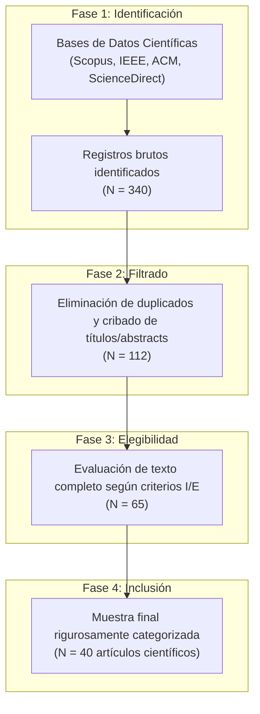
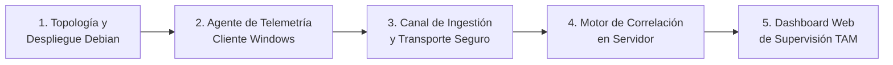
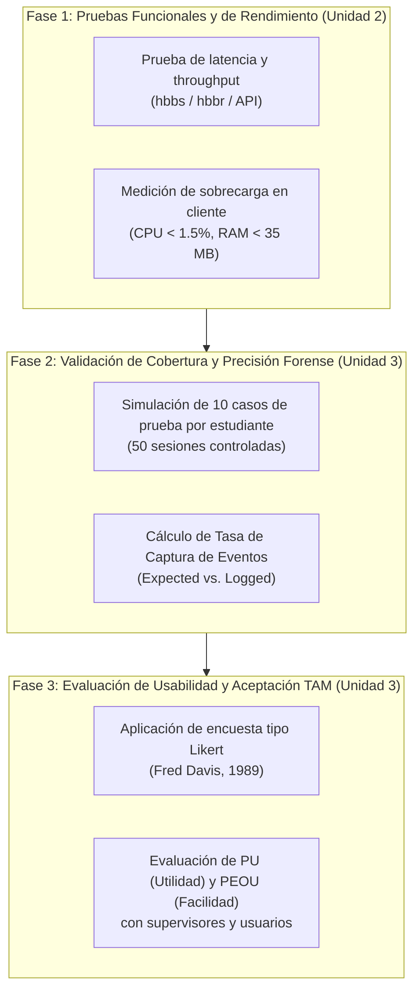

# SECCIÓN 3: METODOLOGÍA
## «Tracking and Analyzing Remote Desktop Connection Logs using RustDesk»

### 3.1. Enfoque y alcance de la revisión documental

La presente investigación adopta un enfoque metodológico mixto con predominio analítico-sintético y de diseño experimental de sistemas. Para la fase de fundamentación teórica y delimitación de la brecha tecnológica, se implementó una revisión sistemática de literatura (RSL) guiada por adaptaciones metodológicas del protocolo PRISMA (*Preferred Reporting Items for Systematic Reviews and Meta-Analyses*), orientada específicamente a la ingeniería de software y la ciberseguridad forense.

El alcance documental se definió bajo un corte temporal decenal (2016–2026), capturando tanto los fundamentos clásicos de correlación de eventos en infraestructuras críticas y plataformas SIEM como los desarrollos más recientes en auditoría de sesiones remotas, mitigación de movimientos laterales (*lateral movement*) y telemetría de sistemas operativos pospandemia. El estudio comprende literatura científica indexada en las principales bases de datos internacionales: Scopus, IEEE Xplore, ACM Digital Library, ScienceDirect (Elsevier) y SpringerLink, complementándose con los estándares de interoperabilidad y gestión de registros del *National Institute of Standards and Technology* (NIST SP 800-92) y el marco jurídico nacional establecido por la Ley N° 31572 (Ley del Teletrabajo en el Perú) y su reglamento (D.S. N° 002-2023-TR).

El análisis documental no se limitó a un inventario pasivo de resúmenes; se estructuró a partir de una triangulación metodológica que contrasta:
1. Las capacidades nativas del software de acceso remoto de código abierto (RustDesk Server OSS y clientes multiplataforma).
2. Los límites forenses de las fuentes de eventos del sistema operativo anfitrión (Windows Event Viewer, Microsoft Sysmon, APIs nativas Win32).
3. Los requisitos organizacionales de trazabilidad y privacidad de los colaboradores bajo marcos laborales modernos.



---

### 3.2. Estrategia de búsqueda y selección de los 40 artículos

La estrategia de recuperación de información se basó en el diseño de cadenas de búsqueda compuestas por operadores booleanos (`AND`, `OR`, `NOT`) y delimitadores de campo aplicados a títulos, resúmenes y palabras clave (*Title/Abstract/Keywords*). Las cadenas se estructuraron combinando tres componentes axiales:

* **Componente A (Plataforma y Protocolo):** `("RustDesk" OR "Remote Desktop" OR "RDP" OR "AnyDesk" OR "TeamViewer" OR "Virtual Desktop Infrastructure")`
* **Componente B (Telemetría y Registro):** `("Log Analysis" OR "Security Event Log" OR "Sysmon" OR "Audit Trail" OR "Telemetry" OR "Provenance")`
* **Componente C (Objetivo Forense / Supervisión):** `("Lateral Movement" OR "Forensic Artifacts" OR "Anomaly Detection" OR "Employee Monitoring" OR "User Behavior Analytics" OR "UEBA")`

#### Ecuación de búsqueda representativa en Scopus / IEEE:
```sql
TITLE-ABS-KEY (
    ("remote desktop" OR "RDP" OR "AnyDesk" OR "TeamViewer" OR "RustDesk") 
    AND ("log" OR "audit" OR "Sysmon" OR "telemetry" OR "artifact") 
    AND ("forensic" OR "anomaly detection" OR "lateral movement" OR "behavior analytics")
) AND PUBYEAR > 2015
```

El proceso de selección se ejecutó en cuatro etapas secuenciales:
1. **Identificación inicial:** Obtención de 340 artículos potencialmente relevantes procedentes de repositorios científicos.
2. **Cribado preliminar (*Screening*):** Eliminación de duplicados y revisión de títulos y resúmenes para descartar estudios de hardware puro, virtualización de servidores no interactiva o telecomunicaciones fuera del alcance de la capa de aplicación y host.
3. **Lectura crítica de texto completo (*Eligibility*):** Evaluación de 65 artículos para comprobar que incluyeran metodologías reproducibles, conjuntos de datos reales o experimentales (como LANL, CERT o entornos de laboratorio) y análisis detallado de artefactos de software.
4. **Consolidación final (*Inclusion*):** Selección definitiva de los **40 artículos científicos** de mayor rigor e impacto dialectal para conformar el marco comparativo del proyecto.

---

### 3.3. Criterios de inclusión y exclusión

Para asegurar la validez metodológica y la pertinencia temática de la muestra documental, se definieron taxativamente los siguientes criterios:

#### Criterios de Inclusión (CI):
* **CI-1:** Investigaciones que analizan empíricamente artefactos forenses, huellas en memoria o registros generados por herramientas de escritorio remoto (RustDesk, AnyDesk, TeamViewer, RDP o Chrome Remote Desktop).
* **CI-2:** Estudios que emplean telemetría a nivel de host basada en el ecosistema Windows (Security Event Logs, eventos de Sysmon, Registro de Windows, llamadas a APIs del kernel/Win32).
* **CI-3:** Investigaciones centradas en la correlación automatizada de logs, arquitecturas SIEM escalables o detección de anomalías secuenciales mediante modelos estadísticos o de Machine Learning / Deep Learning (LSTM, BERT, árboles de decisión).
* **CI-4:** Artículos que discuten formalmente la supervisión laboral remota (*electronic monitoring*), analítica de comportamiento de entidades y usuarios (UEBA) y la preservación de la privacidad y el bienestar laboral.
* **CI-5:** Publicaciones indexadas en revistas Scopus (Q1/Q2/Q3), transacciones IEEE/ACM o conferencias internacionales con revisión por pares (*peer-reviewed*), publicadas preferentemente entre 2016 y 2026.

#### Criterios de Exclusión (CE):
* **CE-1:** Artículos enfocados exclusivamente en la compresión de video, renderizado de gráficos 3D o codecs de streaming multimedia sin análisis de registros ni auditoría de seguridad.
* **CE-2:** Informes comerciales de proveedores (*whitepapers* publicitarios) que carecen de validación experimental y metodología científica replicable.
* **CE-3:** Trabajos limitados a firewalls perimetrales o inspección de paquetes cifrados sin correlación con telemetría del punto final (*endpoint*).
* **CE-4:** Publicaciones con duplicidad de resultados o metodologías no explicadas suficientemente.

---

### 3.4. Matriz de extracción y comparación de la literatura

A partir de los 40 artículos científicos seleccionados, se construyó una matriz analítica multidimensional organizada en cuatro ejes temáticos fundamentales para el proyecto:
* **Eje I:** Informática Forense y Análisis de Artefactos en Software de Escritorio Remoto (10 estudios).
* **Eje II:** Telemetría de Host, Detección de Movimientos Laterales y Sysmon (10 estudios).
* **Eje III:** Procesamiento Automatizado, Parsing y Modelado Inteligente de Logs (12 estudios).
* **Eje IV:** Supervisión del Teletrabajo, Analítica Conductual (UEBA) y Ética/Privacidad (8 estudios).

A continuación se presenta la matriz estructurada con los campos estandarizados: *Autor y Año*, *Objetivo Principal*, *Metodología y Dataset*, *Hallazgos Clave*, *Limitaciones Observadas* y *Transferibilidad/Aporte al Proyecto RustDesk*.

| N° | Eje | Autor(es) y Año | Objetivo de la Investigación | Metodología y Dataset | Principales Hallazgos | Limitaciones Identificadas | Relación y Aporte al Proyecto RustDesk |
|:---:|:---:|:---|:---|:---|:---|:---|:---|
| **1** | I | **Manson (2022)** | Identificar artefactos forenses dejados por TeamViewer en Windows para reconstrucción de sesiones. | Experimental en VMs Windows 10 (controlador y cliente); análisis de disco, RAM y Registro con Autopsy. | Recuperación de timestamps precisos, IPs públicas, transferencias de archivos y persistencia de rastros tras desinstalación. | Dependencia de artefactos locales volátiles que pueden ser eliminados deliberadamente por el usuario. | Fundamenta la necesidad de centralizar inmediatamente los metadatos de sesión de RustDesk en el servidor Debian antes de que puedan alterarse localmente. |
| **2** | I | **Pañeda et al. (2024)** | Evaluar la trazabilidad de exfiltración de archivos mediante AnyDesk, TeamViewer y Chrome Remote Desktop. | Escenarios experimentales en VMs Windows 10 con transferencias de diversos tamaños; captura con Wireshark y auditoría Windows. | TeamViewer registra nombres y rutas completas; AnyDesk oculta nombres de ficheros en logs nativos; Chrome RDP delega evidencia al navegador. | Ninguna herramienta analizada provee por sí sola una vista forense completa; los logs nativos son superficiales. | Justifica técnicamente que RustDesk Server OSS debe complementarse obligatoriamente con Sysmon EID 11 para auditar archivos transferidos/creados. |
| **3** | I | **Thantilage et al. (2026)** | Formular un marco forense para investigar abusos y fraudes mediante AnyDesk en sistemas Windows. | Análisis multi-fuente: logs de AnyDesk, Prefetch, Registro, RAM y Event Logs 4624/4672/7045. | Reconstrucción íntegra de la cadena de eventos; hallazgo de un desfase temporal de 5 a 40 segundos entre la acción en vivo y su escritura en disco. | Alta complejidad en la correlación manual de fuentes heterogéneas sin un motor centralizado. | Aporta el modelo temporal para sincronizar los timestamps de conexión de RustDesk (`hbbs`/`hbbr`) con los eventos del visor de Windows en el Dashboard. |
| **4** | I | **Soni, Kaur, & Bhardwaj (2024)** | Analizar artefactos digitales de AnyDesk en plataformas Windows y Android mediante herramientas forenses. | Entorno controlado con Magnet AXIOM, UFED y Autopsy sobre Windows 10 y Android; análisis de chats y grabaciones. | Extracción exitosa de IDs de AnyDesk, sesiones remotas, IPs de origen/destino y metadatos de archivos transferidos. | Enfoque post-mortem; requiere acceso físico a la imagen de disco forense una vez ocurrido el incidente. | Provee el catálogo de campos obligatorios que el Dashboard debe extraer en tiempo real para supervisión sin requerir peritaje forense forense pesado. |
| **5** | I | **Soni, Kaur, & Aziz (2024)** | Decodificar las interacciones y artefactos de TeamViewer entre entornos Windows y Android. | Adquisición de memoria RAM, análisis del Registro y ficheros `Connections.txt` y `TeamViewer15_Logfile.log`. | Demuestra que la memoria volátil retiene datos de conexión no volcados en disco, pero los logs de texto plano carecen de firma criptográfica. | Vulnerabilidad de los logs locales ante manipulación si no se cuenta con un canal de retransmisión seguro. | Inspira la protección de la telemetría en RustDesk mediante tokens de autenticación API y firma de logs hacia el servidor central Debian. |
| **6** | I | **Aung et al. (2024)** | Desplegar HoneyWin, un honeypot de alta interacción para estudiar accesos no autorizados por RDP/SSH. | Despliegue en Internet por 34 días; 3 hosts Windows 11; monitoreo dual de red y host con tokens de engaño (*deception*). | Más de 5.79 millones de conexiones no solicitadas y 5 accesos RDP exitosos que derivaron en reclutamiento de botnets. | Requiere infraestructura aislada y constante mantenimiento para evitar escape del entorno contenido. | Evidencia la extrema vulnerabilidad de los puertos de escritorio remoto expuestos; respalda el uso de claves Ed25519 en RustDesk para admitir solo clientes autorizados. |
| **7** | I | **Wang et al. (2018)** | Rastrear de forma automatizada ataques de ransomware dirigidos que ingresan mediante conexiones RDP. | Sistema de engaño en 3 capas (red, host, FS) y procesamiento de lenguaje natural para filtrar pistas y lenguaje del teclado. | Tasa de convergencia de rastreo del 98%; atribución precisa del origen geográfico mediante distribución de teclado y portapapeles. | Ineficaz ante atacantes que emplean sesiones automatizadas sin interacción de portapapeles ni teclado interactivo. | Demuestra el valor de capturar metadatos de sesión (distribución de teclado, transferencias de portapapeles) en la auditoría de RustDesk. |
| **8** | I | **Lone & Mir (2019)** | Garantizar la cadena de custodia de evidencia forense digital mediante Hyperledger Composer (Blockchain). | Arquitectura descentralizada "Forensic-Chain" que registra cronológicamente cada interacción sobre la evidencia. | Trazabilidad inalterable, verificación criptográfica de integridad y transparencia multi-actor ante litigios. | Sobrecarga computacional y latencia transaccional no apta para streaming de eventos de alta frecuencia. | Respalda el requerimiento de no repudiación: la base de datos de telemetría de RustDesk debe generar hashes criptográficos de cada sesión cerrada. |
| **9** | I | **Gundu, Panem, & Satheesh (2022)** | Evaluar factores de preparación de "Forense en la Nube como Servicio" (CFaaS) con computación de alto rendimiento. | Comparativa experimental de adquisición forense en estaciones de trabajo, clústeres virtuales y entornos HPC. | HPC alcanza 900.1 MiB/s en captura y encriptación simultánea de flujos de evidencia frente a 498 MiB/s en virtualización. | Costo elevado de infraestructura física no aplicable a pymes o redes académicas pequeñas. | Define los lineamientos de dimensionamiento eficiente de recursos en el servidor Debian para recibir flujos continuos de los 5 clientes sin degradación. |
| **10** | I | **Ruambo et al. (2025)** | Mitigar ataques de fuerza bruta en servicios de acceso remoto mediante perímetros definidos por software (SDP). | Implementación de Single Packet Authorization (SPA) y control dinámico de sesiones RDP/SSH sobre contenedores Docker. | Reducción radical del escaneo y blindaje de servicios remotos sin impacto en el rendimiento de los usuarios legítimos. | Complejidad de configuración de agentes SPA en sistemas operativos cliente heterogéneos. | Justifica la necesidad de proteger los puertos de `hbbs`/`hbbr` en Debian mediante listas de control de acceso y autenticación previa de llaves públicas. |
| **11** | II | **Bai et al. (2021a)** | Detectar movimientos laterales mediante RDP analizando registros de eventos de Windows con Machine Learning. | Datasets LANL (*Comprehensive* y *Unified*); 56 837 sesiones RDP depuradas de Event IDs 4624, 4625 y 4634. | LogitBoost alcanza 99.87% de precisión y 99.73% de sensibilidad modelando intervalos entre sesiones y duración de accesos. | El modelo asume eventos de tipo LogonType 10 nativos de RDP, ausentes en sesiones de captura de pantalla como RustDesk. | Alerta sobre la brecha técnica: el proyecto RustDesk debe generar sus propios eventos de inicio/fin de sesión y correlacionarlos con la sesión local. |
| **12** | II | **Bian et al. (2021)** | Identificar movimiento lateral mediante análisis de grafos sobre registros de autenticación del host. | 230 millones de eventos de autenticación LANL; reducción de 29 a 17 características mediante Pearson; Random Forest. | F1-score de 0.75 y sensibilidad de 98.81% en condiciones de extremo desbalance entre eventos benignos y maliciosos. | Depende fuertemente de la consistencia de eventos del controlador de dominio de Active Directory. | Aporta la formulación de variables conductuales (frecuencia de conexión por hora, tiempo transcurrido entre accesos) para el Dashboard. |
| **13** | II | **Smiliotopoulos et al. (2023)** | Desarrollar una herramienta abierta para estructurar logs de Sysmon y detectar movimiento lateral con ML. | Extracción automatizada de eventos EVTX de Sysmon (EID 1, 3, 7, 11); entrenamiento de clasificadores supervisados. | F1 de 99.41% y AUC de 99.84%; demuestra que la telemetría granular de Sysmon es superior a los Event Logs clásicos de Windows. | Alto volumen de eventos crudos generados; requiere filtrado estricto para no saturar almacenamiento. | Provee la justificación directa para instalar Sysmon en las 5 estaciones cliente Windows y capturar EID 1 (procesos) y EID 11 (ficheros). |
| **14** | II | **Bai et al. (2019)** | Propuesta preliminar de detección de movimiento lateral mediante atributos temporales de sesiones RDP. | Dataset LANL; evaluación comparativa de Naive Bayes, Árboles de Decisión y LogitBoost con remoción de identificadores. | LogitBoost mantiene precisión de 99.87% reduciendo el tiempo de entrenamiento en 80% al eliminar sesgos de nombres de host. | Sensibilidad ante ataques adversariales que manipulan deliberadamente la duración de la sesión. | Refuerza que el Dashboard no debe confiar únicamente en la duración de la conexión, sino en la interacción física efectiva del usuario. |
| **15** | II | **Khutail et al. (2024)** | Evaluar la robustez adversarial e interpretabilidad (XAI) de modelos ML en detección de accesos remotos. | Comparativa de LogitBoost vs. LSTM sobre logs RDP sometidos a perturbaciones FGSM/PGD; explicabilidad con SHAP. | LogitBoost se degrada críticamente ante ruido; LSTM con entrenamiento adversarial resiste conservando Recall de 0.988. | El análisis SHAP reveló dependencia excesiva en la duración de sesión como variable predictiva predominante. | Demuestra la necesidad de incorporar la métrica de inactividad (*idle time*) como contrapeso a la duración total reportada por RustDesk. |
| **16** | II | **Bhardwaj & Rahman (2026)** | Cacería de amenazas avanzadas que abusan de LOLBINs y modificación de servicios de escritorio remoto. | SIEM Elasticsearch con 303 148 logs; inferencia bayesiana, Threat Confidence Score (TCS) y entropía de Shannon. | Probabilidad posterior de 0.778 para alteración de puertos de escritorio remoto; 88.7% de tasa de verdaderos positivos. | Requiere un volumen de telemetría elevado para estabilizar el cálculo de entropía de Shannon. | Provee el diseño conceptual de alertas que se integrarán en el Dashboard ante anomalías operativas en los clientes. |
| **17** | II | **Huang et al. (2025)** | HADES: Detección e investigación de intrusiones en Active Directory mediante analítica de procedencia de red. | Grafo de procedencia a nivel empresarial correlacionando autenticaciones con actividad posterior en RDP, SSH y WMI. | Determina que analizar eventos aislados produce falsos positivos; correlacionar la conexión con el proceso hijo es determinante. | Complejidad algorítmica de escalamiento en grafos para redes corporativas de miles de nodos. | Sustenta la regla de correlación central: Toda conexión de RustDesk debe vincularse temporalmente con los procesos hijos levantados en Windows. |
| **18** | II | **Kwon, Kim, & Kim (2022)** | Estado del arte y arquitectura de soluciones Endpoint Detection and Response (EDR). | Taxonomía de agentes de punto final, recolectores de telemetría de kernel, bases de datos centrales y motores de alerta. | Concluye que la visibilidad moderna exige agentes ligeros no intrusivos que transmitan eventos estructurados vía HTTPS. | Desafío de sobrecarga de CPU y consumo de memoria RAM en estaciones de trabajo de especificaciones modestas. | Provee el patrón arquitectónico exacto para programar el agente colector de telemetría en las 5 máquinas clientes de los estudiantes. |
| **19** | II | **Bai, Wang, & Chen (2021b)** | Análisis sistemático de vulnerabilidades y soluciones de seguridad derivadas de la adopción masiva del teletrabajo. | Revisión de vectores de ataque en acceso remoto, mecanismos de autenticación robusta y gestión de endpoints distribuidos. | El perímetro corporativo desapareció; la superficie de ataque reside en los endpoints domésticos sin monitoreo gestionado. | Enfoque teórico panorámico sin diseño de prototipo específico de recolección de eventos. | Justifica la relevancia institucional del proyecto de monitoreo como mecanismo de visibilidad operacional para teletrabajadores. |
| **20** | II | **Grigaliūnas et al. (2023)** | Mapeo del alcance de etapas de ciberataques y su impacto en la ciber-sostenibilidad y resiliencia de TI. | Simulación en MATLAB y validación en entorno real (Windows Server, Linux, SIEM) mapeando 18 etapas del Unified Kill Chain. | La visibilidad temprana en etapas de acceso inicial y ejecución remota previene la captura de credenciales privilegiadas en un 13% más. | Exige integración de hasta 31 fuentes de detección simultáneas para cobertura completa. | Inspira la clasificación de eventos del Dashboard en niveles de criticidad (Informativo, Advertencia, Crítico). |
| **21** | III | **Du et al. (2017)** | DeepLog: Detección y diagnóstico de anomalías en registros del sistema mediante redes neuronales profundas (LSTM). | Modelado de secuencias de logs como lenguaje natural; evaluación sobre 11M de logs HDFS y 1.3M de OpenStack. | F-measure de 96% a 98% aprendiendo patrones de ejecución normales a partir de cantidades reducidas de logs limpios. | Demanda computacional de entrenamiento offline no viable para ser ejecutada dentro de un servidor Debian ligero. | Demuestra teóricamente que los flujos de eventos de una sesión remota siguen un orden sintáctico que permite detectar anomalías. |
| **22** | III | **Le & Zhang (2021)** | NeuralLog: Detección de anomalías basada en logs sin requerir analizadores sintácticos previos (*log parsing*). | Procesamiento semántico directo mediante tokenización WordPiece y transformadores BERT; evaluación en HDFS, BGL y Spirit. | Puntuaciones F1 superiores a 0.95 y latencia de detección de 3.1 ms por secuencia, evitando la pérdida semántica del parsing rígido. | Alto consumo de memoria en inferencia al cargar pesos de modelos tipo BERT. | Orienta el diseño del recolector de logs hacia la estructuración nativa en JSON desde el cliente para evitar la necesidad de parsing complejo en el servidor. |
| **23** | III | **He et al. (2018)** | Drain: Algoritmo automático de parsing de logs para análisis de grandes volúmenes de datos en tiempo real. | Árbol de profundidad fija para agrupar mensajes de log no estructurados en plantillas estructuradas de forma determinista. | Supera a métodos basados en minería de texto en precisión y velocidad; estándar de facto en procesamiento de logs industriales. | Sensible a variaciones imprevistas en los formatos de fecha y mensajes polimórficos de depuración. | Provee el fundamento algorítmico para normalizar los mensajes de depuración de RustDesk (`hbbs`/`hbbr`) en Debian. |
| **24** | III | **Meng et al. (2019)** | LogAnomaly: Detección no supervisada de anomalías secuenciales y cuantitativas en logs no estructurados. | Framework semántico con técnica *template2vec* evaluado sobre datasets HDFS y BGL; detección dual sin etiquetas. | Reducción drástica de falsos positivos frente a métodos que solo analizan identificadores estáticos de eventos. | Requiere ventanas temporales amplias para estabilizar las matrices de co-ocurrencia semántica. | Aporta la distinción conceptual entre anomalías secuenciales (procesos fuera de orden) y cuantitativas (exceso de clics o inactividad). |
| **25** | III | **He et al. (2021)** | Encuesta exhaustiva sobre análisis automatizado de logs para ingeniería de confiabilidad de sistemas. | Revisión sistemática del ciclo de vida de los logs: generación, recolección, compresión, parsing y diagnóstico de fallos. | El análisis de logs es el pilar central de la observabilidad moderna; el mayor cuello de botella reside en la calidad de la ingesta. | Diversidad de esquemas de datos impide estándares universales de almacenamiento entre fabricantes. | Guía la arquitectura de la base de datos central en Debian: almacenamiento desacoplado de metadatos de sesión y eventos del sistema. |
| **26** | III | **Zhu et al. (2023)** | LogHub: Colección masiva de conjuntos de datos de logs del sistema para investigación basada en IA. | Recopilación, limpieza y estandarización de logs de 16 sistemas distribuidos y operativos del mundo real. | Identifica la heterogeneidad de formatos como el mayor obstáculo para la reproducibilidad de herramientas de auditoría. | Los datasets públicos son mayormente sintéticos o carecen de correlación con actividad de usuarios finales. | Justifica la necesidad de crear un dataset propio durante las pruebas de la Unidad 3 con los 5 estudiantes. |
| **27** | III | **Landauer et al. (2020)** | Encuesta sobre técnicas de agrupamiento (*clustering*) de registros del sistema para ciberseguridad. | Clasificación sistemática de algoritmos de agrupamiento de logs para compresión, firmas y detección de valores atípicos. | Las técnicas de clustering no supervisado permiten resumir miles de eventos similares en una sola alerta comprensible. | Pérdida de granularidad forense si los hiperparámetros de similitud se configuran con umbrales demasiado laxos. | Fundamenta la función del Dashboard para agrupar ráfagas de eventos Sysmon (ej. 50 lecturas de archivos) en un solo ítem consolidado. |
| **28** | III | **Coppolino et al. (2016)** | Framework para dominar la heterogeneidad en correlación de eventos de seguridad multicapa (GET). | Módulo Generic Event Translator integrado en OSSIM SIEM; probado en infraestructuras críticas y pagos móviles. | La correlación cruzada entre capas (red, sistema operativo, aplicación) multiplica la precisión de detección de intrusiones. | Sobrecarga de latencia introducida por el pipeline de traducción y normalización de eventos heterogéneos. | Provee el fundamento teórico para correlacionar eventos de Capa de Aplicación (RustDesk) con Capa de Host (Windows/Sysmon). |
| **29** | III | **Vianello et al. (2013)** | Motor escalable de correlación SIEM aplicado a la infraestructura de los Juegos Olímpicos. | Procesamiento en paralelo y correlación distribuida de flujos masivos de eventos en memoria sin cuellos de botella. | Demuestra la superioridad de procesar eventos en memoria antes de persistir en disco para evitar colapso de I/O. | Requiere clústeres dedicados con alta asignación de memoria RAM para buffering distribuido. | Orienta el diseño del backend en FastAPI para mantener una cola en memoria (`asyncio.Queue`) que reciba los datos de los 5 clientes. |
| **30** | III | **Sheeraz et al. (2024)** | Diseño de motor de correlación SIEM innovador (OC) optimizado mediante procesamiento multihilo y SIMD. | Desarrollo en C con librería Intel Hyperscan para coincidencia de patrones en paralelo; comparado contra Simple Event Correlator. | Procesamiento de logs a velocidad de línea con latencia casi nula y cero pérdidas de paquetes durante picos de tráfico. | Complejidad de mantenimiento a nivel de código de bajo nivel y dependencia de instrucciones de hardware específicas. | Sustenta la eficiencia de la arquitectura de RustDesk y orienta la elección de FastAPI con esquemas Pydantic para validación ultrarrápida. |
| **31** | III | **Guo, Yuan, & Wu (2021)** | LogBERT: Detección de anomalías en logs mediante modelos de lenguaje contextuales autorregresivos. | Enfoque no supervisado basado en BERT que aprende secuencias normales de eventos de logs y evalúa probabilidades condicionales. | Supera a LSTM y métodos tradicionales al capturar dependencias bidireccionales de largo alcance entre eventos distantes. | Requiere entrenamiento previo exhaustivo con GPU, inviable en entornos operativos mínimos. | Aporta la base teórica para interpretar que una desconexión abrupta sin evento previo de cierre representa una posible anomalía. |
| **32** | III | **Kurniawan et al. (2022)** | VloGraph: Marco de grafos de conocimiento virtuales para análisis distribuido de logs de seguridad. | Mapeo de logs heterogéneos distribuidos hacia consultas SPARQL semánticas alineadas con MITRE ATT&CK sin centralizar datos brutos. | Ejecución eficiente de consultas forenses complejas federadas preservando la soberanía de almacenamiento de cada host. | Dependencia de esquemas ontológicos rígidos y latencia variable según la conectividad del host remoto. | Inspira la estandarización del esquema JSON del agente Windows para mapear eventos a categorías legibles por humanos en el Dashboard. |
| **33** | IV | **Jeske (2022)** | Experiencias de trabajadores remotos con el monitoreo electrónico durante COVID-19: implicaciones para la salud. | Revisión selectiva en Emerald, Springer y Wiley sobre salud ocupacional, estrés laboral y vigilancia electrónica. | El monitoreo intrusivo continuo genera agotamiento, estrés y desconfianza; la supervisión basada en objetivos y metadatos técnicos es aceptada. | Estudio cualitativo de corte psicosocial sin implementación de herramientas técnicas de software. | **Pilar ético central del proyecto:** Justifica excluir keyloggers y capturas de cámara web, priorizando métricas objetivas de actividad del sistema. |
| **34** | IV | **Thompson & Molnar (2023)** | Encuesta nacional canadiense sobre la adopción y uso de aplicaciones de monitoreo de empleados. | Encuesta empírica a 402 ejecutivos y gerentes; 51.7% usa software de monitoreo; 90.8% lo justifica por protección de datos. | Brecha entre el discurso de ciberseguridad corporativo y la práctica real de fiscalización de tiempos y movimientos laborales. | Muestra restringida a empresas de Canadá; los autores advierten necesidad de contrastar con legislaciones locales. | Justifica la necesidad organizacional del proyecto para pymes, demostrando que la demanda principal es la seguridad de los activos de información. |
| **35** | IV | **Mühlhoff & Michael (2023)** | Revisión sistemática de literatura sobre vigilancia y monitoreo laboral en la era del teletrabajo. | Análisis de 150+ publicaciones clasificando tecnologías de seguimiento de clics, tiempo activo y herramientas de supervisión. | El software de monitoreo comercializado actúa como "caja negra" opaca, erosionando los derechos de privacidad de los empleados. | No evalúa soluciones autohospedadas de código abierto como alternativa viable a los monopolios comerciales. | Provee el argumento de soberanía de datos: RustDesk autohospedado en Debian evita que metadatos laborales viajen a nubes extranjeras. |
| **36** | IV | **Rashid, Kamal, & Al-Shaikh (2022)** | Encuesta integral sobre analítica del comportamiento de usuarios y entidades (UEBA) para ciberseguridad. | Taxonomía de técnicas de perfilado estadístico, detección de anomalías de cuentas y reglas conductuales basadas en roles. | La transición de seguridad perimetral a UEBA permite descubrir amenazas internas legítimas que abusan de privilegios asignados. | Elevada tasa de falsos positivos iniciales durante la fase de aprendizaje de la línea base del usuario. | Fundamenta el módulo analítico del Dashboard para calcular promedios de conexión diaria y marcar desviaciones atípicas. |
| **37** | IV | **Kamatchi & Uma (2025)** | Revisión sistemática sobre detección de amenazas internas basada en el comportamiento del usuario. | Evaluación de 2 929 artículos y 12 datasets (CERT, LANL); estudio de técnicas supervisadas vs. semisupervisadas. | Las transferencias de archivos y los horarios anómalos de inicio de sesión son los dos indicadores de mayor peso predictivo. | Escasez de conjuntos de datos con actividades de usuarios reales debido a restricciones de confidencialidad. | Orienta al sistema a prestar especial atención a los accesos remotos ocurridos fuera de la jornada laboral oficial bajo la Ley 31572. |
| **38** | IV | **Calvo et al. (2025)** | RBD24: Conjunto de datos etiquetado con actividades de riesgo a partir de logs de aplicaciones reales. | 586 510 muestras de 1 772 usuarios en universidad española; vector de 83 indicadores temporales y de red; modelo XGBoost. | F1 de 0.70 demostrando que los patrones conductuales de riesgo son diferenciables estadísticamente en redes académicas. | El dataset incluye solo logs de aplicaciones web (Capa 7), omitiendo telemetría a nivel de sistema operativo local. | Demuestra la viabilidad de modelar comportamiento de estudiantes/usuarios en entornos universitarios como el de la UPT. |
| **39** | IV | **Martín et al. (2021)** | Detección de anomalías conductuales del usuario en federaciones de identidad mediante biometría pasiva. | Análisis de dinámica de tecleo (Manhattan/KNN) y movimiento del mouse (One-Class SVM) en 11 usuarios durante sesiones activas. | Identificación de usurpación de sesión en menos de 19 interacciones con mínima latencia y sin interrumpir al usuario. | Dependencia de librerías en primer plano que pueden ser burladas por scripts de automatización del mouse. | Respaldó la decisión del proyecto: en lugar de biometría pasiva invasiva, emplear la API determinista `GetLastInputInfo` para medir inactividad. |
| **40** | IV | **Kent & Souppaya (2006)** | Guía NIST SP 800-92: Guía de gestión de registros de seguridad informática para organizaciones. | Estándar de ingeniería de procesos del NIST: generación, transmisión segura, almacenamiento, análisis y retención de logs. | Los registros dispersos en clientes carecen de valor legal o forense; la infraestructura debe garantizar sincronización horaria y no alteración. | Documento normativo de principios generales sin código de implementación para tecnologías específicas modernas. | **Estándar arquitectónico rector del proyecto:** Garantiza que la topología Debian-Windows cumpla con NTP, hashing y centralización reglamentaria. |

---

### 3.5. Procedimiento de análisis y formulación de la propuesta

El diseño y estructuración de la solución soberana se fundamenta en los hallazgos de la matriz comparativa previa. La formulación de la propuesta se divide en **cinco etapas de ingeniería de sistemas**:



#### Etapa 1: Diseño de la Topología de Red y Servidor Central (Linux Debian 12)
* Se selecciona Debian 12 por su proverbio de estabilidad de kernel, consumo mínimo de memoria RAM (<300 MB en reposo) y nulo costo de licenciamiento.
* Se orquesta mediante contenedores Docker la suite **RustDesk Server OSS**:
  * `hbbs` (puertos `21115-21116/tcp`, `21116/udp`): Servicio de identificación, registro de clientes y señalización NAT/P2P.
  * `hbbr` (puerto `21117/tcp`): Servicio de retransmisión (*relay*) para sesiones donde no sea posible el túnel directo.
* Se configura un par de llaves asimétricas con el algoritmo criptográfico **Ed25519**. La llave pública se distribuye a los 5 clientes; ningún cliente externo sin dicha llave puede negociar sesiones con el servidor, bloqueando escaneos maliciosos (Aung et al., 2024).

#### Etapa 2: Desarrollo del Agente Colector de Telemetría Windows
Para subsanar la brecha de "caja negra" identificada en AnyDesk y TeamViewer (Pañeda et al., 2024; Thantilage et al., 2026), se programa un agente en segundo plano que corre en las 5 máquinas nominales:
1. **Lector de sesiones RustDesk:** Inspecciona las modificaciones en `%AppData%\RustDesk\log\` para capturar marcas exactas de conexión, desconexión e ID del par remoto.
2. **Medición de Inactividad Física Real (*Idle Time*):**
   A través de la API nativa de Windows `user32.dll`, el agente invoca periódicamente:
   $$\text{Tiempo Inactivo (segundos)} = \frac{\text{GetTickCount}() - \text{GetLastInputInfo}()}{1000}$$
   Esto permite clasificar cada intervalo de la sesión en **Tiempo Activo** o **Tiempo Inactivo**, resolviendo el problema de las sesiones abandonadas o "presentismo digital".
3. **Telemetría de Host con Sysmon:**
   * **Sysmon Event ID 1 (Process Creation):** Captura `UtcTime`, `ProcessGuid`, `Image` (ej. `WINWORD.EXE`, `powershell.exe`), `CommandLine` y `User`.
   * **Sysmon Event ID 11 (FileCreate):** Captura archivos creados o sobrescritos durante la sesión remota en directorios de trabajo sensibles.

#### Etapa 3: Canal de Transporte y Protocolo de Ingestión
* Cada cliente transmite su paquete de telemetría hacia el servidor Debian mediante peticiones seguras HTTP POST sobre TLS.
* Los paquetes se estructuran en formato JSON estandarizado, incluyendo un encabezado de autenticación con Bearer Token individual por cada alumno (`CLIENT_TOKEN_01` a `CLIENT_TOKEN_05`).
* **Resiliencia ante desconexiones:** El agente Windows implementa un búfer local SQLite transaccional. Si la conexión de red hacia el servidor Debian falla, los eventos se acumulan localmente y se transmiten automáticamente cuando el enlace se restablece, preservando la cadena de custodia.

#### Etapa 4: Motor de Correlación Temporal en el Servidor
En el servidor Debian, una API desarrollada con **FastAPI** recibe los flujos de telemetría y ejecuta el algoritmo de correlación:
$$\text{Sesión Remota } S_k = \langle \text{HostID}, \text{RemoteID}, t_{\text{inicio}}, t_{\text{fin}} \rangle$$
$$\text{Evento de Host } E_i = \langle \text{HostID}, t_e, \text{Tipo}, \text{Detalle} \rangle$$
$$\text{Regla de Correlación: } E_i \in S_k \iff (t_{\text{inicio}} \le t_e \le t_{\text{fin}}) \land (\text{HostID}_{E_i} == \text{HostID}_{S_k})$$
De esta manera, el sistema vincula automáticamente qué archivos se abrieron y qué programas se ejecutaron *durante* el periodo exacto de la sesión de RustDesk, diferenciándolos de la actividad efectuada de forma local en la máquina.

#### Etapa 5: Aplicación Dashboard de Supervisión y Auditoría
La interfaz web centralizada ofrece:
* Vista de estado de los 5 clientes nominales (En línea, Desconectado, En sesión remota activa).
* Muro de métricas: Tiempo de conexión total vs. Tiempo activo real vs. Tiempo de inactividad.
* Línea de tiempo forense interactiva (*timeline*) que reconstruye la sesión minuto a minuto.
* Filtros por estudiante, rango de fechas y tipo de evento para inspecciones rápidas.

---

### 3.6. Plan de validación posterior: funcionamiento, cobertura y evaluación con usuarios

La verificación formal de la solución se completará progresivamente en las Unidades 2 y 3 mediante tres fases experimentales rigurosas:



#### 1. Pruebas Cuantitativas de Rendimiento Técnico y Sobrecarga
* **Sobrecarga en el Endpoint Windows:** Monitoreo con el *Performance Monitor* de Windows para verificar que el agente de telemetría mantenga un consumo promedio de CPU inferior al **1.5%** y una huella de memoria RAM inferior a **35 MB**, garantizando que no degrade el trabajo cotidiano del alumno.
* **Latencia de Señalización e Ingestión:** Medición del tiempo transcurrido desde que ocurre un evento en el cliente hasta que impacta en la base de datos de Debian (objetivo técnico: $< 500\text{ ms}$ en red local / $< 1.5\text{ s}$ en enlace remoto WAN).

#### 2. Protocolo de Pruebas de Cobertura y Trazabilidad (50 Escenarios)
Se ejecutará una batería de **10 escenarios experimentales controlados por cada una de las 5 estaciones de trabajo** (total: 50 sesiones de prueba), simulando conductas legítimas y anómalas:
* *Escenario A (Actividad estándar):* Conexión remota de 30 minutos con edición continua de documentos y navegación técnica.
* *Escenario B (Simulación de ausentismo / "Presentismo digital"):* Conexión remota establecida durante 60 minutos con abandono físico total del puesto (validación del umbral de detección de `GetLastInputInfo`).
* *Escenario C (Ejecución de procesos sospechosos):* Lanzamiento de comandos administrativos (`cmd.exe`, `powershell.exe -enc`, scripts no autorizados) durante la sesión remota para auditar la captura en Sysmon EID 1.
* *Escenario D (Transferencia y creación de ficheros):* Creación deliberada de archivos `.docx`, `.pdf` y `.zip` en carpetas locales para auditar la detección de Sysmon EID 11.

La métrica de cobertura se cuantificará mediante la **Tasa de Captura de Eventos ($TCE$)**:
$$TCE = \left( \frac{\text{Eventos Registrados en Dashboard}}{\text{Eventos Reales Ejecutados en la Prueba}} \right) \times 100\%$$
El criterio de aceptación de la arquitectura exige un $TCE \ge 98\%$.

#### 3. Evaluación de Aceptación Tecnológica mediante el Modelo TAM (Davis, 1989)
Al término de las pruebas de la Unidad 3, se administrará un instrumento cuantitativo estandarizado basado en escala Likert (1: Totalmente en desacuerdo a 5: Totalmente de acuerdo) a supervisores técnicos y a los integrantes del equipo para contrastar los dos constructos teóricos de Davis:

* **Utilidad Percibida (Perceived Usefulness - PU):**
  * *PU-1:* El Dashboard centralizado reduce el tiempo necesario para auditar sesiones remotas frente a la revisión manual de logs locales.
  * *PU-2:* La diferenciación entre tiempo de conexión e inactividad física mejora la precisión en la supervisión de actividades laborales/académicas.
  * *PU-3:* El sistema proporciona evidencia verificable que previene imputaciones infundadas de ausentismo.
  * *PU-4:* La solución fortalece la seguridad de la información de los activos de la red.

* **Facilidad de Uso Percibida (Perceived Ease of Use - PEOU):**
  * *PEOU-1:* La interacción con los filtros de búsqueda del Dashboard web es clara y autoexplicativa.
  * *PEOU-2:* La visualización cronológica (*timeline*) facilita la comprensión de los eventos sin exigir conocimientos forenses avanzados.
  * *PEOU-3:* El despliegue del cliente RustDesk y del agente de telemetría requiere una fricción mínima de configuración.

Los resultados serán procesados mediante estadística descriptiva (media y desviación estándar) y análisis de consistencia interna (Alfa de Cronbach), validando empíricamente si la propuesta cumple con la hipótesis central del ensayo científico: conciliar gobernanza institucional soberana, usabilidad sin fricción y respeto irrestricto a la intimidad del usuario.
